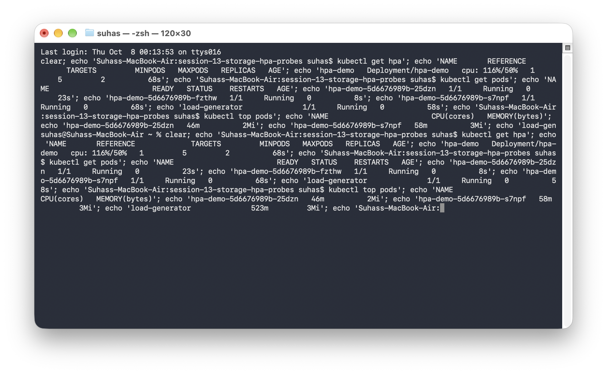
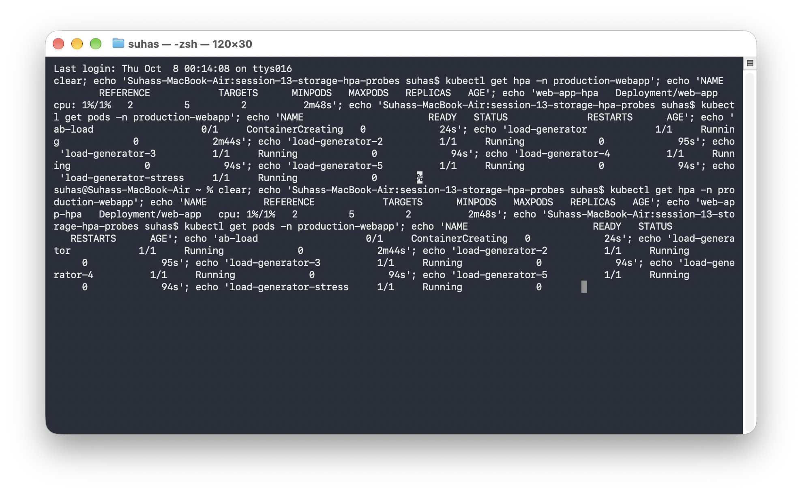

# Session 13: Storage, HPA & Probes

This repository contains the tasks completed for Session 13.

## Task 1: Kubernetes Volumes
The documentation for Kubernetes volumes (including `emptyDir`, `hostPath`, `PersistentVolume`, `PersistentVolumeClaim`, `StorageClass`, and Dynamic provisioning) with practical examples can be found here:
- [Kubernetes Volumes Documentation](./01-kubernetes-volumes/README.md)

## Task 2: HPA Hands-on
We deployed the application and HPA, followed by a load generator to simulate traffic.

**HPA Scaling Output Screenshot:**

## Task 3: Mini Project
The mini-project has been fully deployed in the `production-webapp` namespace, including the Namespace, PVC, Deployment, Service, and HPA.

**Mini-Project Scaling Output Screenshot:**

