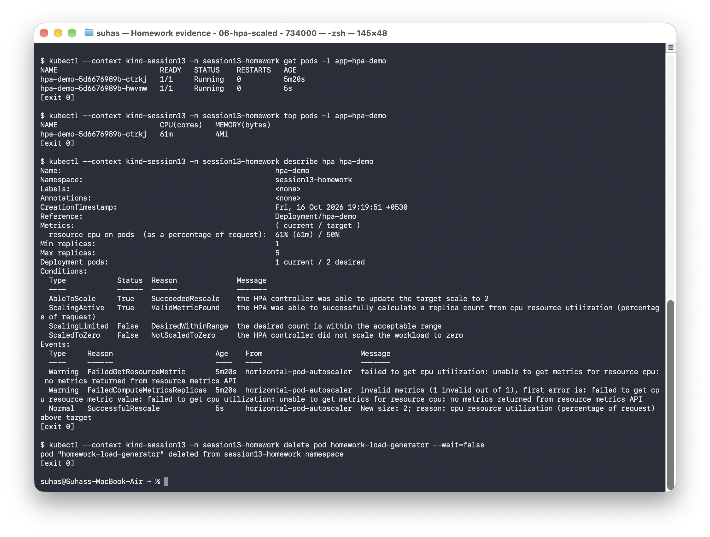
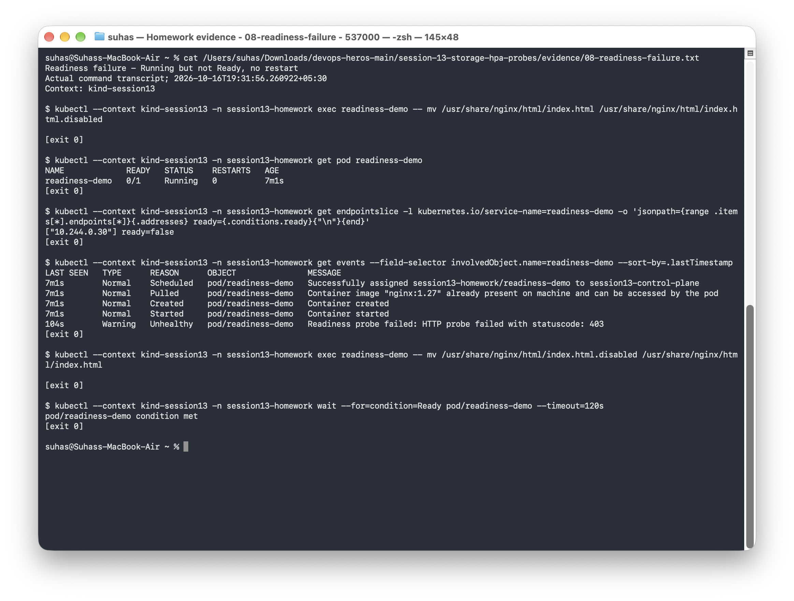
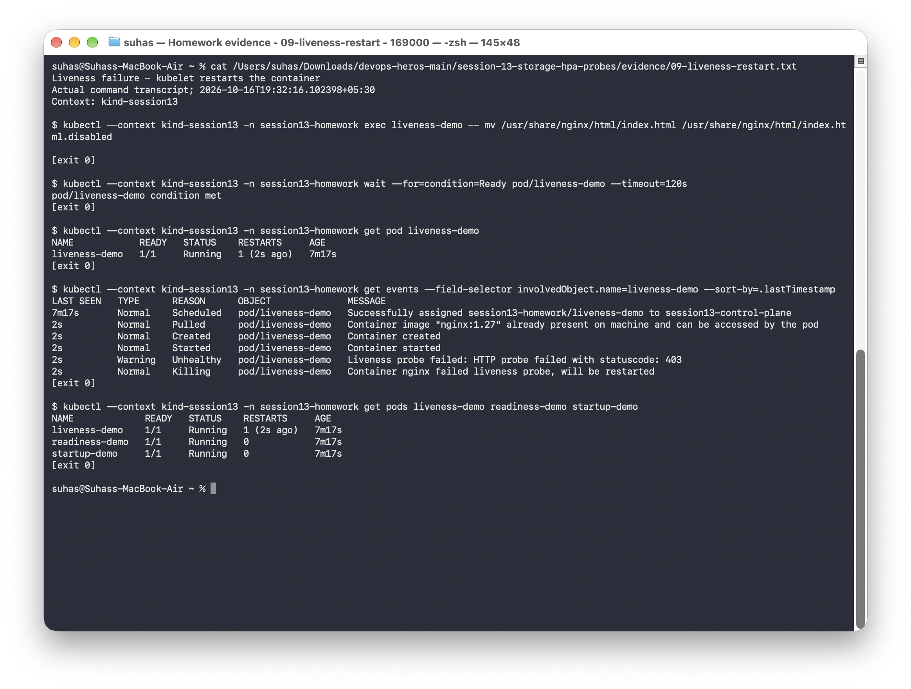
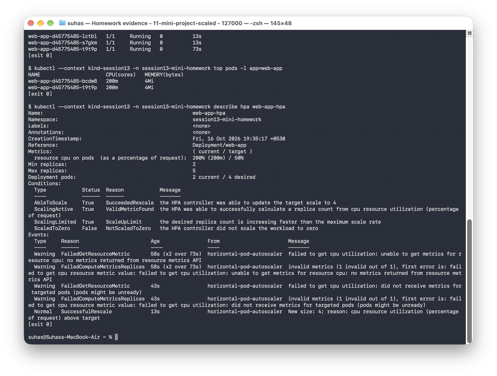
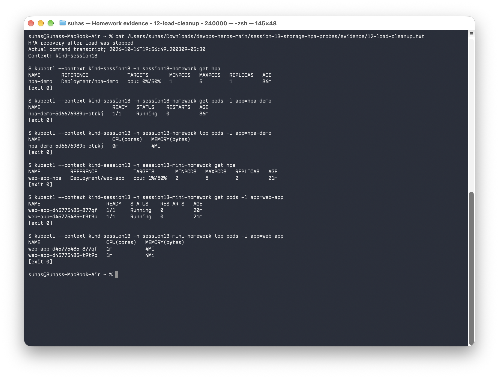

# Session 13: Kubernetes Storage, HPA & Probes

## Lab setup

I used the Kind cluster `kind-session13` for these exercises. The storage and HPA labs run in `session13-homework`, and the mini-project runs in `session13-mini-homework`. The mini-project manifests use `production-webapp` by default; the lab script sets its own namespace.

| Exercise | Result |
|---|---|
| Volume documentation | [emptyDir, hostPath, PV, PVC, StorageClass and dynamic provisioning](01-kubernetes-volumes/README.md) |
| HPA hands-on | CPU rose from 0% to 61% against the unchanged 50% target; the deployment grew from one to two ready Pods |
| Mini-project | Data survived Pod replacement, HTTP returned 200, all probes were configured, and controlled CPU work produced 200% utilization and a scale-out from two to four ready Pods |

## Storage verification

1. **emptyDir:** wrote `/data/student.txt`, deleted/recreated the Pod, and verified the file was absent.
2. **hostPath:** repeated the write/delete/recreate exercise and read the original contents on the same local node. The data stays on that node.
3. **Static PV/PVC:** explicitly bound `student-pvc` to `session13-homework-pv`. Setting `storageClassName: ""` prevents the default provisioner from allocating a different volume. The file survived deletion of only the Pod.
4. **Dynamic storage:** added [sc.yaml](03-storageclass/sc.yaml) and a [consumer Pod](03-storageclass/pod.yaml). The `rancher.io/local-path` provisioner created a new PV after the consumer was scheduled; the claim reached `Bound`.

The StorageClass uses Kind’s local-path provisioner. For Minikube or a cloud cluster, choose a provisioner supported by that environment. These labs use storage on a single node.

## HPA verification

The [deployment](04-hpa/deployment.yaml), [Service](04-hpa/service.yaml), [HPA](04-hpa/hpa.yaml), and [24-worker HTTP load generator](04-hpa/load-generator.yaml) were applied. The HPA remained at a 50% CPU target. The command output and screenshots below show the change in CPU usage and replica count.

For the mini-project, I ran a 120-second CPU workload inside the containers because requests to the static Nginx page did not generate enough CPU usage. I checked the ready Pods and `SuccessfulRescale` events alongside the HPA output, since the displayed replica count can lag behind the Deployment.

## Probe verification

| Probe | Exercise | Observation |
|---|---|---|
| Startup | Deploy the configured startup probe | Pod reached `1/1 Running` |
| Readiness | Temporarily remove the served index file | HTTP probe returned 403; Pod stayed `Running` with `0/1` ready and zero restarts; EndpointSlice reported `ready=false` |
| Readiness recovery | Restore the index file | Pod returned to Ready |
| Liveness | Temporarily remove the served index file | Kubelet restarted the container; restart count increased to one and the fresh container recovered |

## Commands and evidence

From the repository root:

```bash
python3 scripts/run_session13.py
# Resume only the probe/mini-project sections if needed:
python3 scripts/run_session13.py probes
python3 scripts/run_session13.py mini
```

The script saves command output for each exercise. During persistence tests, it deletes and recreates the Pods while keeping their PVCs.

## Recorded evidence

The text files contain the full command output; the screenshots show the main results.

| Exercise | Full output | Terminal screenshot |
|---|---|---|
| Session 13 - local cluster prerequisites | [Transcript](evidence/00-environment.txt) | [Screenshot](screenshots/00-environment.png) |
| emptyDir - data is lost when the Pod is recreated | [Transcript](evidence/01-emptydir.txt) | [Screenshot](screenshots/01-emptydir.png) |
| hostPath - data survives Pod recreation on the same local node | [Transcript](evidence/02-hostpath.txt) | [Screenshot](screenshots/02-hostpath.png) |
| Static PV/PVC - data survives deletion of only the Pod | [Transcript](evidence/03-persistent-storage.txt) | [Screenshot](screenshots/03-persistent-storage.png) |
| StorageClass - on-demand local PV provisioning | [Transcript](evidence/04-dynamic-storage.txt) | [Screenshot](screenshots/04-dynamic-storage.png) |
| HPA - baseline before load | [Transcript](evidence/05-hpa-baseline.txt) | [Screenshot](screenshots/05-hpa-baseline.png) |
| HPA - CPU load and scale-out | [Transcript](evidence/06-hpa-scaled.txt) | [Screenshot](screenshots/06-hpa-scaled.png) |
| Startup, readiness and liveness probes - healthy baseline | [Transcript](evidence/07-probes-healthy.txt) | [Screenshot](screenshots/07-probes-healthy.png) |
| Readiness failure - Running but not Ready, no restart | [Transcript](evidence/08-readiness-failure.txt) | [Screenshot](screenshots/08-readiness-failure.png) |
| Liveness failure - kubelet restarts the container | [Transcript](evidence/09-liveness-restart.txt) | [Screenshot](screenshots/09-liveness-restart.png) |
| Mini-project - deployment, persistent data, probes and Service | [Transcript](evidence/10-mini-project.txt) | [Screenshot](screenshots/10-mini-project.png) |
| Mini-project - autoscaling under controlled CPU load | [Transcript](evidence/11-mini-project-scaled.txt) | [Screenshot](screenshots/11-mini-project-scaled.png) |

### Selected screenshots









## Recovery after load removal

After the load stopped, the standalone HPA returned to one ready Pod at 0% CPU, and the mini-project returned to two ready Pods at 1% CPU. Both were below the 50% target. See the [recovery output](evidence/12-load-cleanup.txt).


