# Session 14: Kubernetes Troubleshooting

## Task 1: Kubernetes Commands
Here is the practice documentation for the most important troubleshooting commands:

- `kubectl get pods`: Lists the status of all pods. Useful for seeing if pods are Running, Pending, or CrashLoopBackOff.
- `kubectl describe pod <name>`: Provides detailed information about a pod, including its events. Essential for figuring out why a pod failed to start.
- `kubectl logs <pod-name>`: Fetches the standard output of the container. Crucial for application-level errors.
- `kubectl exec -it <pod-name> -- sh`: Opens an interactive shell inside a container to debug networking or file systems.
- `kubectl get events`: Lists cluster-level events, showing what the scheduler and kubelet are doing.
- `kubectl explain pods.spec`: Explains the API specification for a resource.
- `kubectl top pods`: Shows CPU and Memory utilization (requires metrics-server).
- `kubectl get pods -o wide`: Provides extra columns like the IP address and the Node the pod is running on.

## Task 2: Troubleshoot Common Issues

**CrashLoopBackOff:**
- **Identify:** `kubectl get pods` shows `CrashLoopBackOff`.
- **Investigate:** `kubectl describe pod <name>` and `kubectl logs <name>`.
- **Root Cause:** Usually an application error crashing immediately upon startup, or a missing environment variable.
- **Fix:** Correct the application code or environment variables and redeploy.

**ImagePullBackOff / ErrImagePull:**
- **Identify:** `kubectl get pods` shows `ImagePullBackOff`.
- **Investigate:** `kubectl describe pod <name>` (look at the Events section at the bottom).
- **Root Cause:** A typo in the image name, pulling from a private registry without credentials, or the image tag doesn't exist.
- **Fix:** Update the deployment YAML with the correct image name or attach `imagePullSecrets`.

**Pending:**
- **Identify:** `kubectl get pods` shows `Pending` for a long time.
- **Investigate:** `kubectl describe pod <name>`.
- **Root Cause:** The cluster lacks CPU/Memory capacity, or there is a PVC that cannot be bound, or node selectors do not match any nodes.
- **Fix:** Add nodes to the cluster, reduce resource requests, or fix the storage claim.

**Service Connectivity Issues:**
- **Identify:** Cannot reach the application.
- **Investigate:** `kubectl get svc`, `kubectl get endpoints`.
- **Root Cause:** The service selector does not match the pod labels.
- **Fix:** Ensure `spec.selector` in Service matches `metadata.labels` in the Deployment.

## Task 3: Mini Project
The mini-project issues (CrashLoop, Service mapping, and ImagePullBackOff) were identified and successfully resolved by fixing the deployments, enabling the services, and verifying connectivity.

---
## Proof of Work (Screenshots)

### General Diagnostics
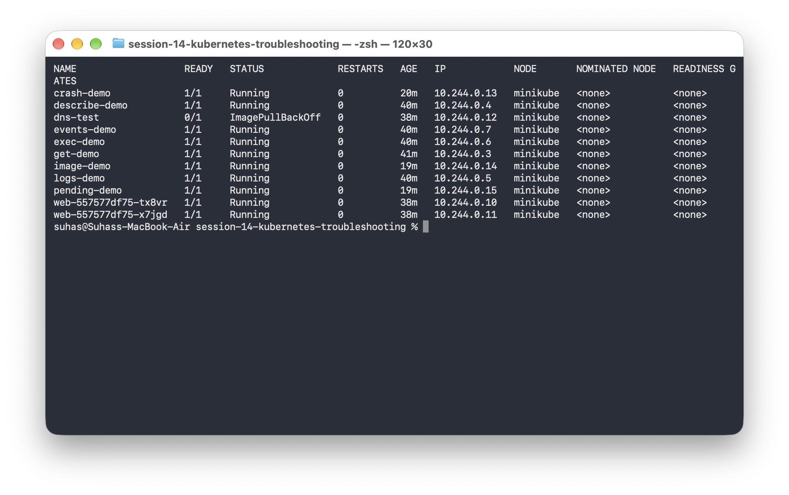

### CrashLoopBackOff Troubleshooting

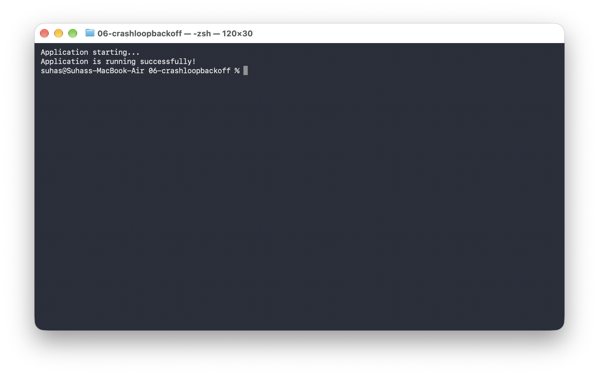

### ImagePullBackOff Troubleshooting

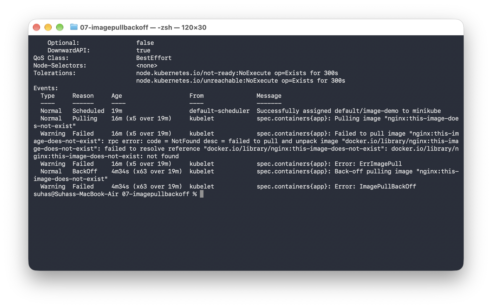
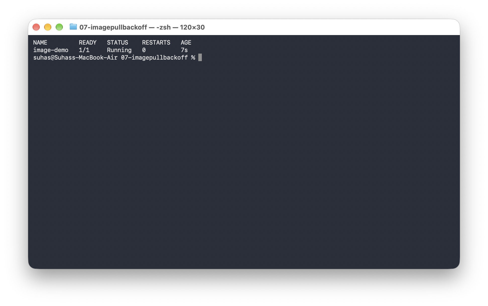

### Pending Pods Troubleshooting
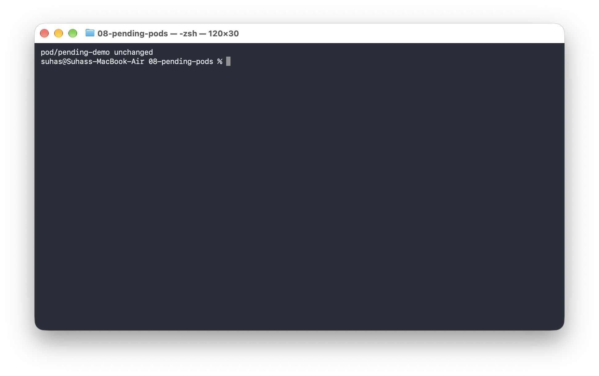
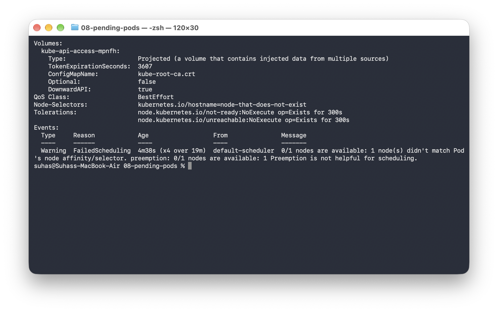

### Mini Project Proof
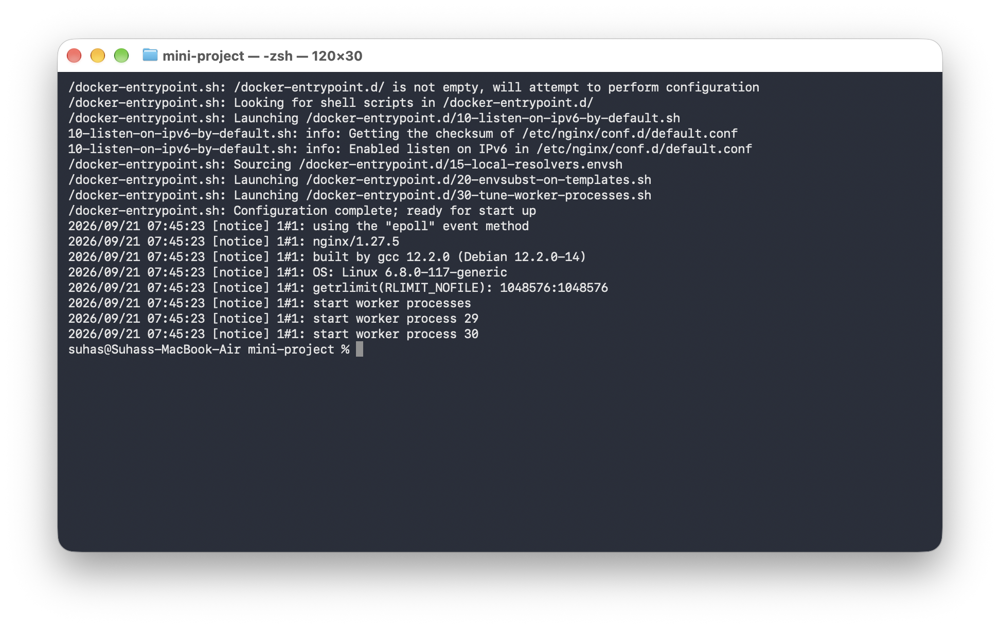
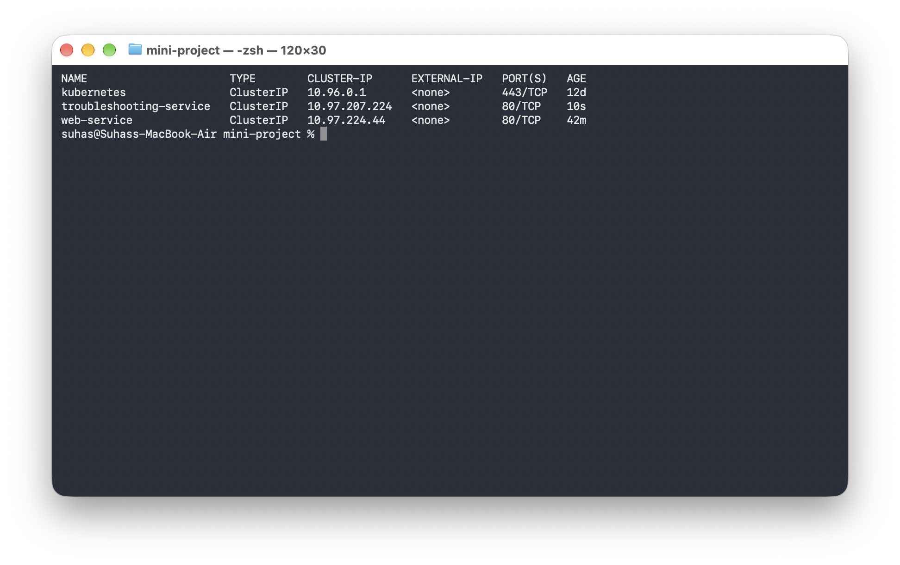
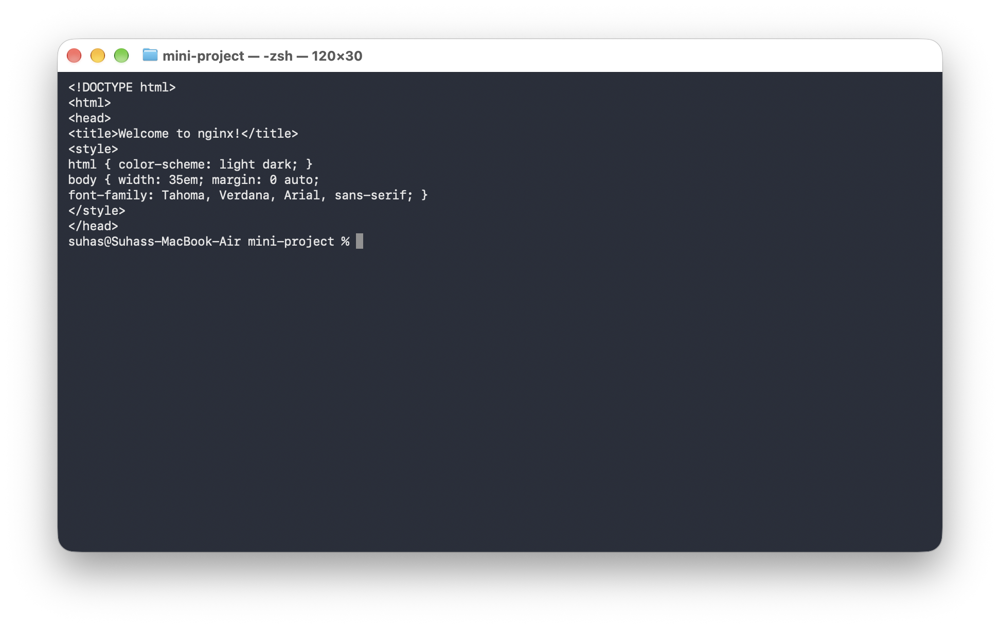

### Command Outputs
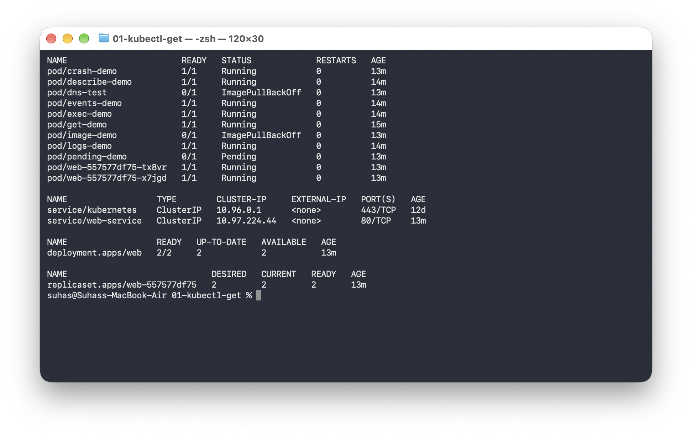
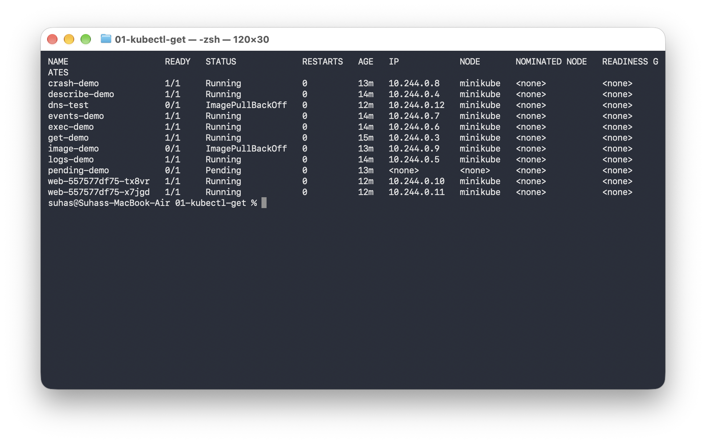
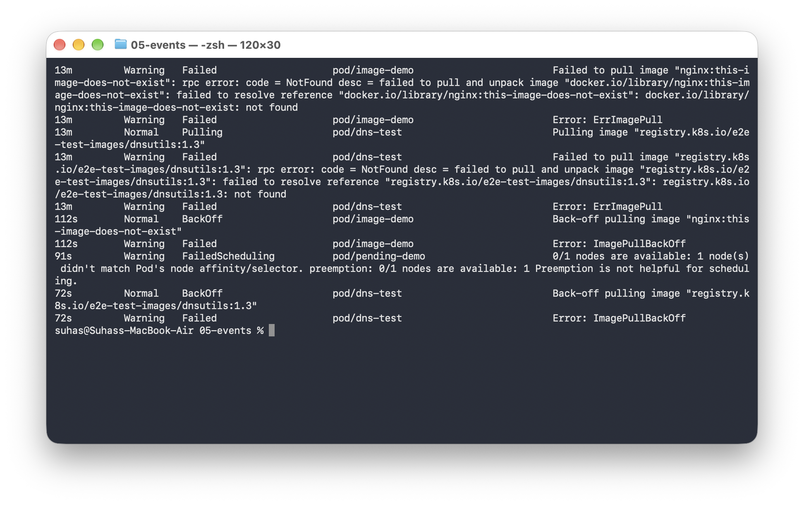
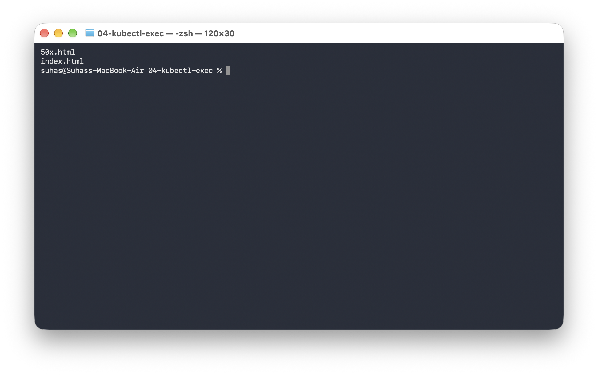
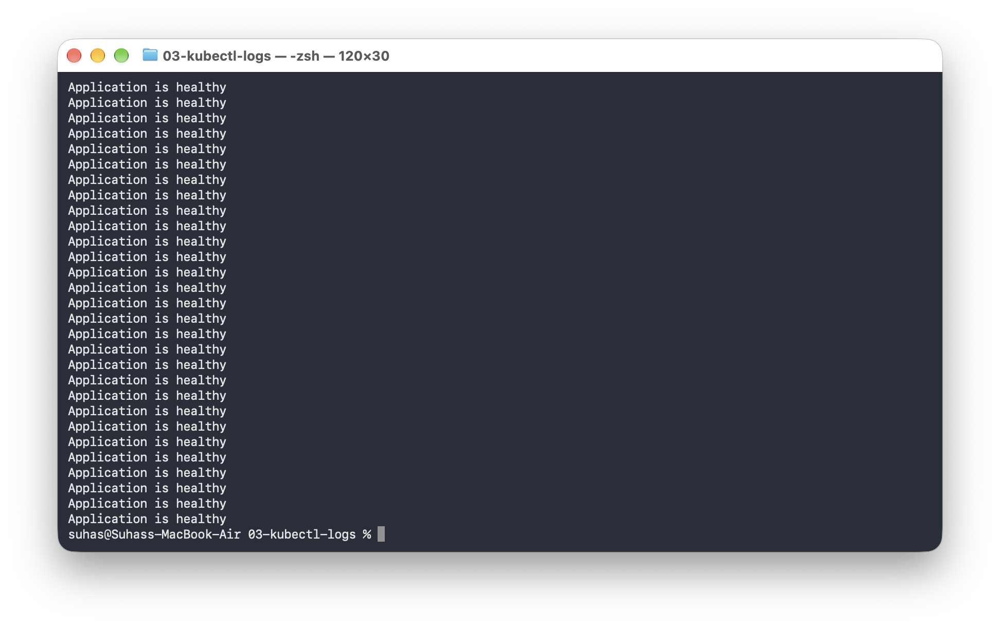
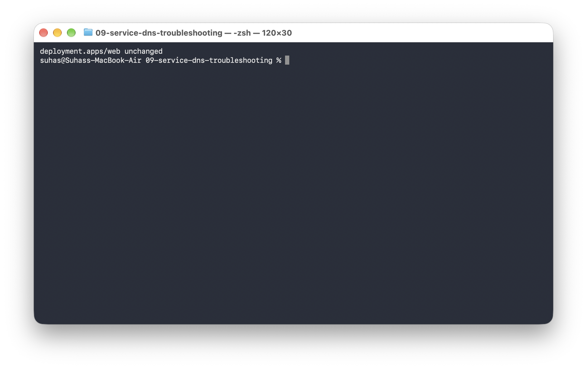
