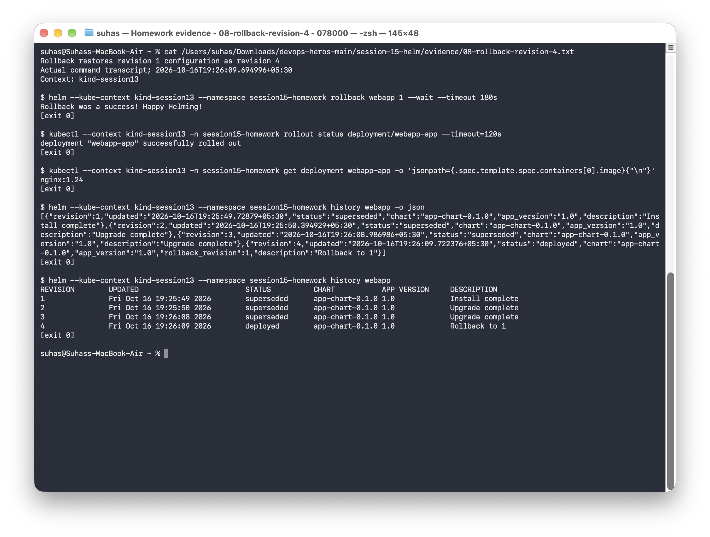
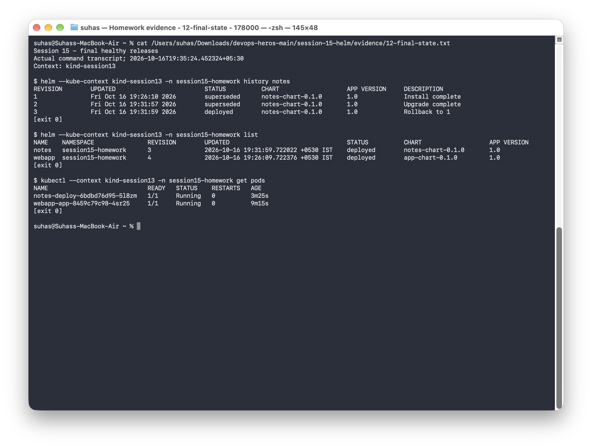

# Session 15: Helm

## Lab setup

I used Helm `v4.3.0` with the Kind cluster `kind-session13` and namespace `session15-homework`.

## Task 1: Helm commands

| Command | What was executed |
|---|---|
| `helm create` | Created the [practice chart](practice/demo-chart/Chart.yaml) |
| `helm install` | Installed `demo-release`, `webapp`, and the packaged `notes` chart |
| `helm list` | Inspected releases and verified removal of the practice release |
| `helm status` | Inspected the deployed practice release and its resources |
| `helm get` | Captured user-supplied values and complete release details with `helm get all` |
| `helm upgrade` | Changed Nginx image versions and applied production values for the notes chart |
| `helm history` | Recorded each revision and its state |
| `helm rollback` | Restored earlier configurations and checked the resulting Pods |
| `helm uninstall` | Removed only `demo-release` and verified its Pods were gone |
| `helm repo` | Added and updated the official Helm examples repository |
| `helm search` | Searched that repository for available charts |

The practice chart installs Nginx `1.27`. Its `appVersion` field is chart metadata; the image tag is set through the chart values.

## Task 2: Complete rollback workflow

I installed Nginx `1.24`, upgraded to `1.25` and then `1.27`, and rolled back to the first revision.

| Revision | Operation | Verified image | Final history state |
|---|---|---|---|
| 1 | Install | `nginx:1.24` | superseded |
| 2 | Upgrade | `nginx:1.25` | superseded |
| 3 | Upgrade again | `nginx:1.27` | superseded |
| 4 | `helm rollback webapp 1` | `nginx:1.24` | deployed; `Rollback to 1` |

```bash
helm --kube-context kind-session13 -n session15-homework install webapp ./07-install-upgrade/app-chart --set image.tag=1.24 --wait
helm --kube-context kind-session13 -n session15-homework upgrade webapp ./07-install-upgrade/app-chart --set image.tag=1.25 --wait
helm --kube-context kind-session13 -n session15-homework upgrade webapp ./07-install-upgrade/app-chart --set image.tag=1.27 --wait
helm --kube-context kind-session13 -n session15-homework history webapp
helm --kube-context kind-session13 -n session15-homework rollback webapp 1 --wait
helm --kube-context kind-session13 -n session15-homework history webapp
```

Run these from this session directory on a fresh exercise release. A rollback creates a new revision; it does not erase revisions 2 and 3.

## Task 3: Notes mini-project

The [custom chart](mini-project/notes-chart/Chart.yaml) was linted, packaged as [notes-chart-0.1.0.tgz](packages/notes-chart-0.1.0.tgz), and installed from that package. Development values set one replica and `ENVIRONMENT=development`. Production values set three replicas and `ENVIRONMENT=production`. A rollback created revision 3 and restored development values.

The `notes` and `webapp` Pods were healthy after rollback. I tested `notes-svc` from a separate client Pod and received `HTTP/1.1 200 OK`.

The mini-project uses Nginx to practice chart packaging, environment-specific values, upgrades, and rollbacks.

## Run the lab

```bash
# From the repository root, using fresh exercise releases:
python3 scripts/run_session15.py
```

The script checks the image after each upgrade and confirms that rollback creates revision 4. To remove the exercise releases when finished:

```bash
helm --kube-context kind-session13 -n session15-homework uninstall notes webapp
```

## Recorded evidence

The text files contain the full command output; the screenshots show the main results.

| Exercise | Full output | Terminal screenshot |
|---|---|---|
| Session 15 - Helm and local cluster | [Transcript](evidence/00-environment.txt) | [Screenshot](screenshots/00-environment.png) |
| Helm create, lint, install, list and status | [Transcript](evidence/01-create-install.txt) | [Screenshot](screenshots/01-create-install.png) |
| Helm get - values and complete release details | [Transcript](evidence/02-get.txt) | [Screenshot](screenshots/02-get.png) |
| Helm uninstall - remove only the practice release | [Transcript](evidence/03-uninstall.txt) | [Screenshot](screenshots/03-uninstall.png) |
| Helm repo and search commands | [Transcript](evidence/04-repository-search.txt) | [Screenshot](screenshots/04-repository-search.png) |
| Rollback exercise - install revision 1 | [Transcript](evidence/05-revision-1.txt) | [Screenshot](screenshots/05-revision-1.png) |
| Rollback exercise - upgrade to revision 2 | [Transcript](evidence/06-revision-2.txt) | [Screenshot](screenshots/06-revision-2.png) |
| Rollback exercise - upgrade to revision 3 | [Transcript](evidence/07-revision-3.txt) | [Screenshot](screenshots/07-revision-3.png) |
| Rollback restores revision 1 configuration as revision 4 | [Transcript](evidence/08-rollback-revision-4.txt) | [Screenshot](screenshots/08-rollback-revision-4.png) |
| Notes chart - lint, package and development deployment | [Transcript](evidence/09-mini-project-install.txt) | [Screenshot](screenshots/09-mini-project-install.png) |
| Notes chart - production values and upgrade | [Transcript](evidence/10-mini-project-upgrade.txt) | [Screenshot](screenshots/10-mini-project-upgrade.png) |
| Notes chart - rollback and healthy final state | [Transcript](evidence/11-mini-project-rollback.txt) | [Screenshot](screenshots/11-mini-project-rollback.png) |
| Session 15 - final healthy releases | [Transcript](evidence/12-final-state.txt) | [Screenshot](screenshots/12-final-state.png) |
| Helm create - chart scaffolding | [Transcript](evidence/13-helm-create.txt) | [Screenshot](screenshots/13-helm-create.png) |

### Selected screenshots




