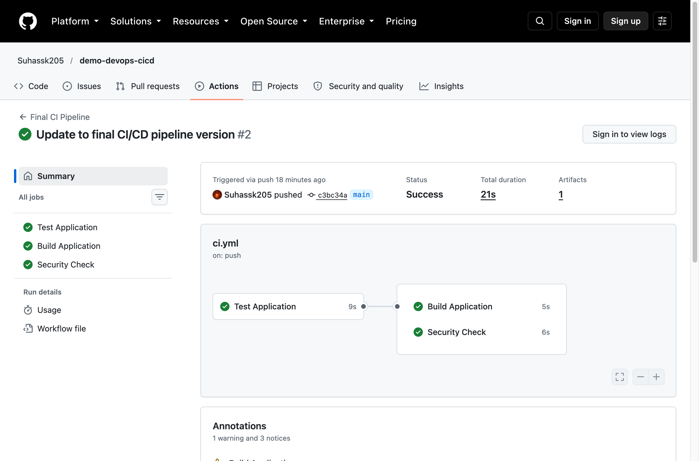
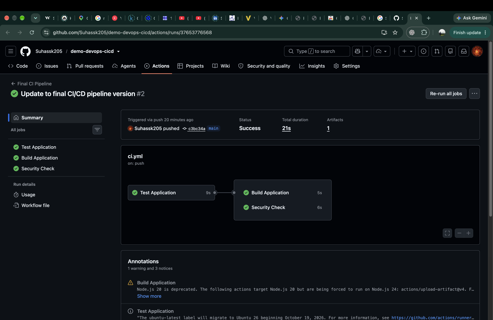

# Session 16 Homework Submission

**Repository:** [demo-devops-cicd](https://github.com/Suhassk205/demo-devops-cicd)
**Actions/Workflows:** [View All Actions](https://github.com/Suhassk205/demo-devops-cicd/actions)
**Latest Run Details:** [Pipeline Run #37653776568](https://github.com/Suhassk205/demo-devops-cicd/actions/runs/37653776568)

## Pipeline Overview

Below is the successful completion of the CI/CD pipeline on the main branch:

## Job Execution Details

The workflow executed successfully with the following jobs:
- **Test Application**
- **Security Check**
- **Build Application**

