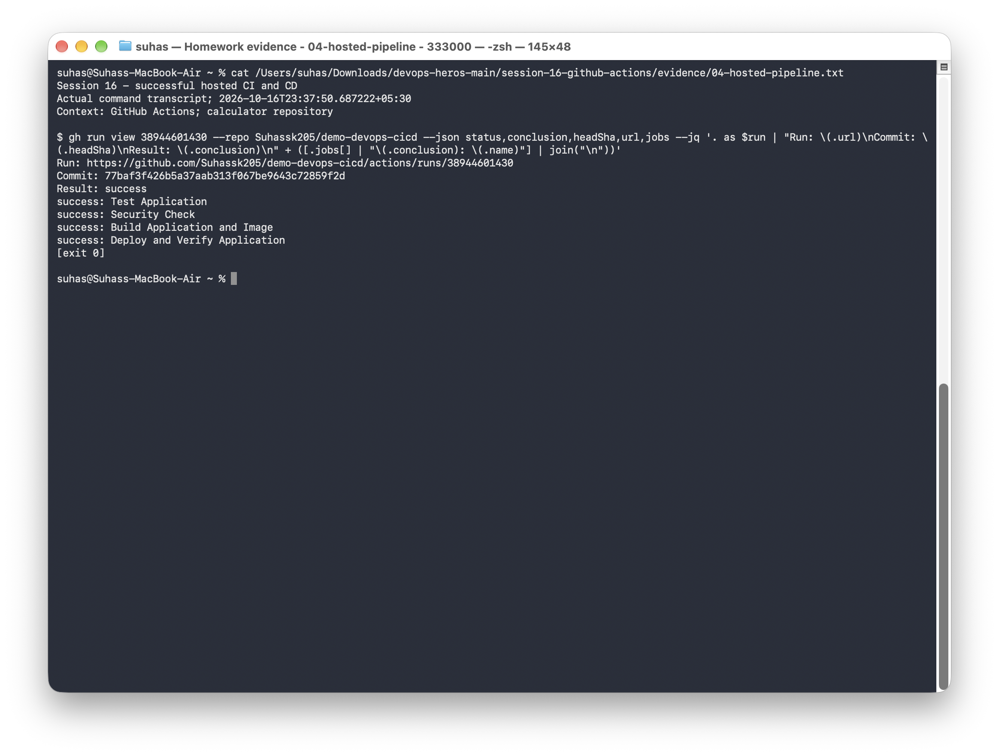
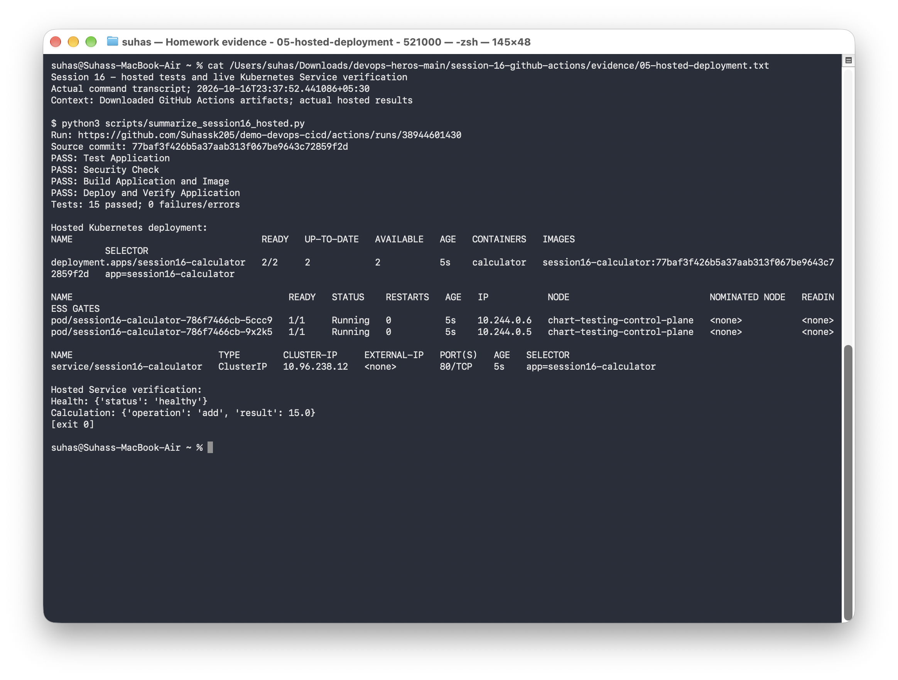
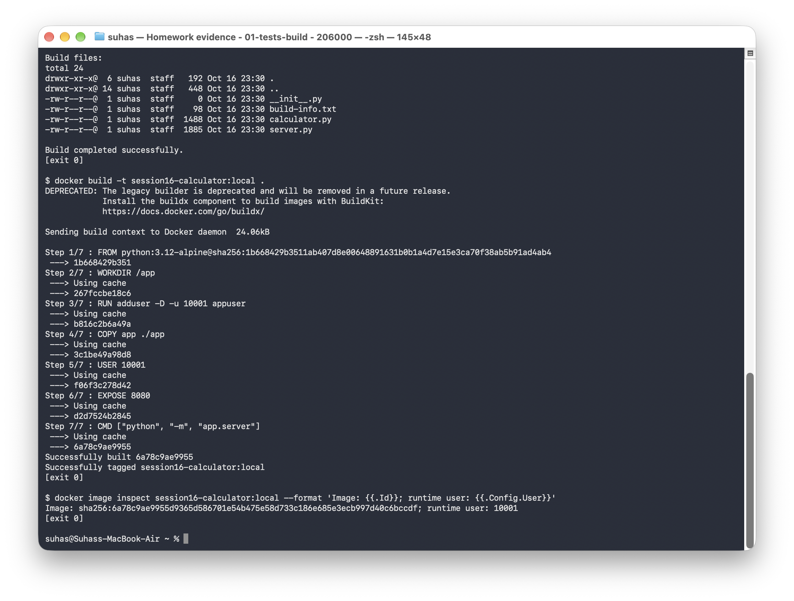
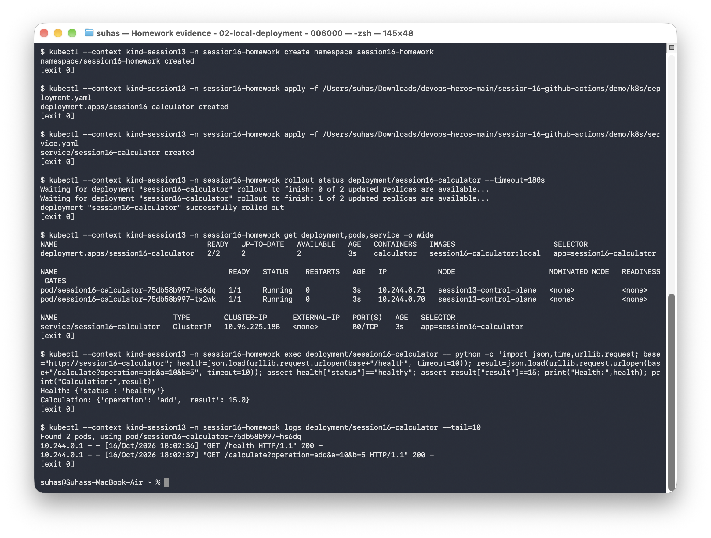
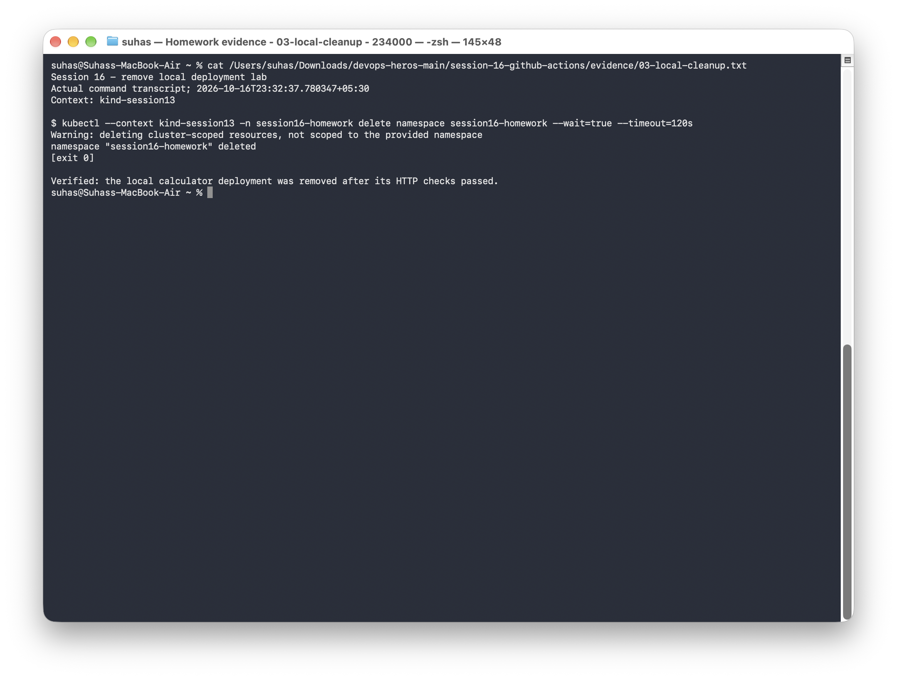

# Session 16: CI/CD & GitHub Actions

**Name:** Suhas

**Application repository:** [demo-devops-cicd](https://github.com/Suhassk205/demo-devops-cicd)

**Workflow:** [Calculator CI and CD](https://github.com/Suhassk205/demo-devops-cicd/blob/main/.github/workflows/ci.yml)

This project automates the calculator application's path from source code to a running Kubernetes deployment. CI tests and packages the application; CD deploys the built container and checks the live Service.

## Task 1: Application and Docker image

The original calculator supports addition, subtraction, multiplication, and division from the command line. I added an HTTP interface so the deployment can be checked through a network Service.

| File | Purpose |
|---|---|
| [Calculator](demo/app/calculator.py) | Arithmetic functions and interactive CLI |
| [HTTP service](demo/app/server.py) | Health check and calculation endpoints |
| [Tests](demo/tests/) | Arithmetic, HTTP responses, invalid input, and division by zero |
| [Dockerfile](demo/Dockerfile) | Container running as non-root UID 10001 |
| [Build script](demo/build.sh) | Package application source and build information |
| [Workflow copy](demo/.github/workflows/ci.yml) | The workflow published in the application repository |
| [Deployment](demo/k8s/deployment.yaml) and [Service](demo/k8s/service.yaml) | Two replicas, health probes, resource limits, and service routing |

A copy of the application is included in [demo/](demo/README.md), alongside the coursework documentation.

## Task 2: CI pipeline

```text
Source push -> tests -> sensitive-file check -> application package and Docker image
    -> uploaded container artifact -> CD deployment -> live HTTP checks
```

| Job | Steps and result checks |
|---|---|
| Test Application | Set up Python, install test dependencies, run 15 tests, and upload a JUnit report |
| Security Check | Check for `.env`, `.pem`, and `.key` files |
| Build Application and Image | Run the build script, build a commit-tagged container, and upload the package and image artifacts |
| Deploy and Verify Application | Download the image, deploy it to Kind, wait for rollout, and check the application through its Service |

Tests must pass before the sensitive-file check, and both must pass before the build. A failed dependency prevents the following job from running. The sensitive-file check is a basic classroom check; the dedicated scanners are covered in Session 17.

### GitHub Actions concepts used

| Concept | Use in this project |
|---|---|
| Workflow | `.github/workflows/ci.yml` defines the pipeline |
| Triggers | Pushes and pull requests to `main`, plus manual dispatch |
| Jobs and steps | Separate test, security, build, and deploy jobs; each job contains its commands and actions |
| Runner | GitHub-hosted Ubuntu machine for each job |
| Dependencies | `needs` connects the jobs and enforces successful completion |
| Artifacts | Source package, built container, JUnit tests, and deployment reports move between jobs or remain available for inspection |
| Permissions and secrets | Repository access is read-only; artifact transfer uses GitHub's workflow authentication, with no custom registry or AWS credential |

## Task 3: CD pipeline

The deployment job runs after a successful build on a push to `main`. It downloads the image artifact from CI instead of rebuilding the application. It then creates a temporary Kind cluster, loads the image, substitutes the source commit's tag in the Deployment, and applies the manifests.

The Deployment requests two replicas and checks `/health` for readiness and liveness. Its ClusterIP Service maps port 80 to the application's port 8080.

```bash
kubectl -n session16-homework rollout status deployment/session16-calculator --timeout=180s
kubectl -n session16-homework get deployment,pods,service -o wide
```

The HTTP verification runs from a Pod through `http://session16-calculator`. It asserts that `/health` returns `healthy` and `/calculate?operation=add&a=10&b=5` returns 15. Bounded retries allow the new Service's network rules to settle. Results and application logs are uploaded as `deployment-reports`.

CD uses a temporary cluster for each hosted run; the cluster is removed when the runner finishes.

## Successful hosted CI/CD run

The [complete GitHub Actions run](https://github.com/Suhassk205/demo-devops-cicd/actions/runs/38944601430) passed all four jobs for source commit [`77baf3f`](https://github.com/Suhassk205/demo-devops-cicd/commit/77baf3f426b5a37aab313f067be9643c72859f2d).

| Stage | Hosted result |
|---|---|
| Tests | 15 passed; 0 failures or errors |
| Sensitive-file check | Passed |
| Application and image build | Passed; commit-tagged container transferred as an artifact |
| Kubernetes deployment | Two ready replicas, both `1/1 Running` with zero restarts |
| HTTP verification | Health returned `healthy`; addition returned `15.0` |

The deployed image was `session16-calculator:77baf3f426b5a37aab313f067be9643c72859f2d`, matching the image built by CI.

[Hosted run output](evidence/04-hosted-pipeline.txt) · [Tests and deployment summary](evidence/05-hosted-deployment.txt) · [Complete job log](evidence/06-hosted-run.log) · [Downloaded reports](evidence/hosted-reports/) · [Run metadata](evidence/hosted-run.json)





## Local execution and verification

From the repository root:

```bash
cd session-16-github-actions/demo
python3 -m venv .venv
source .venv/bin/activate
pip install -r requirements.txt
pytest -v
bash build.sh
docker build -t session16-calculator:local .
```

The local checks passed all 15 tests. I loaded the image into `kind-session13`, deployed two replicas in `session16-homework`, and checked the application through its Service.

```text
Health: {'status': 'healthy'}
Calculation: {'operation': 'add', 'result': 15.0}
```

The container ran as UID 10001. Both Pods were `1/1 Running` with zero restarts. I removed the local namespace after verification.

[Tests and build output](evidence/01-tests-build.txt) · [Deployment and HTTP output](evidence/02-local-deployment.txt) · [Cleanup output](evidence/03-local-cleanup.txt)







To repeat the local verification, use the prepared Python environment and run `python scripts/run_session16.py` from the repository root.
