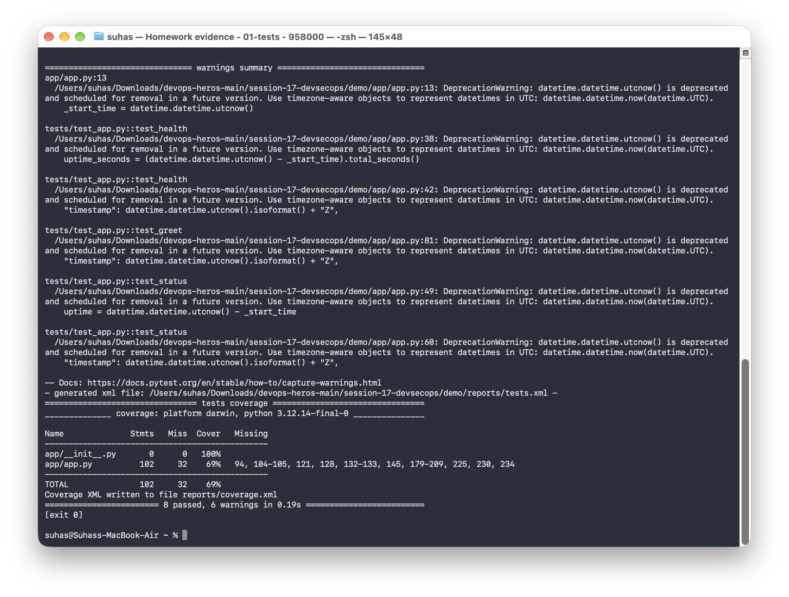
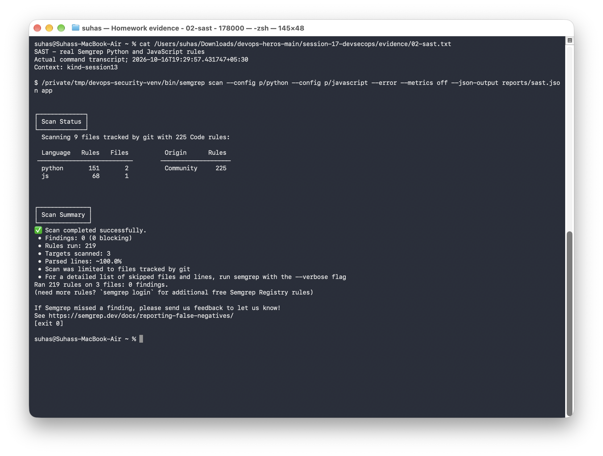
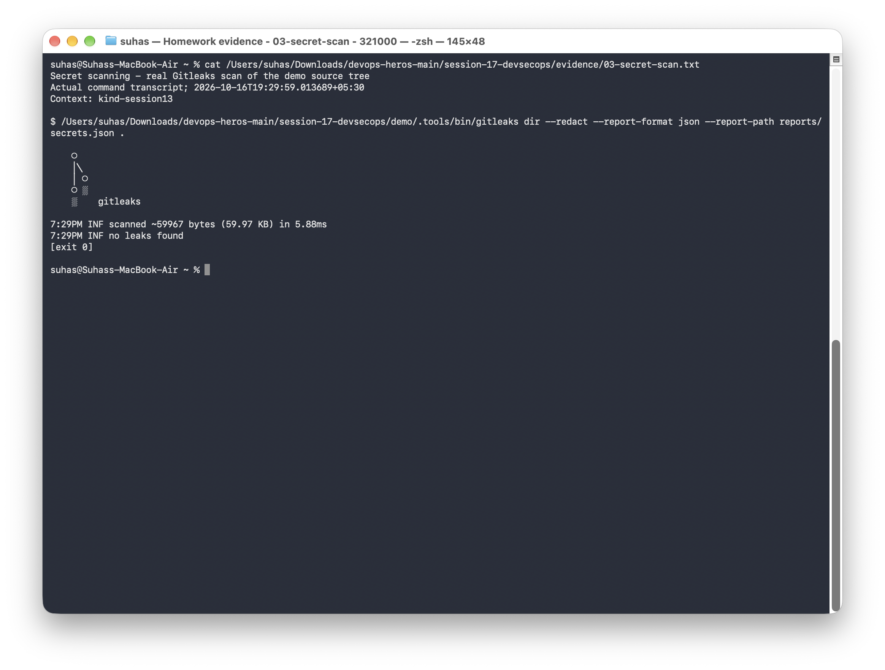
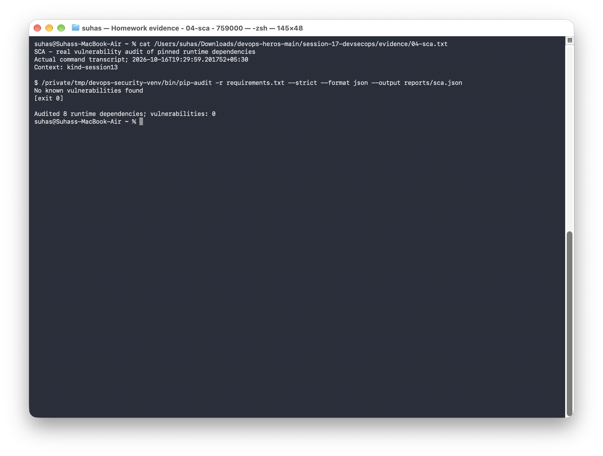
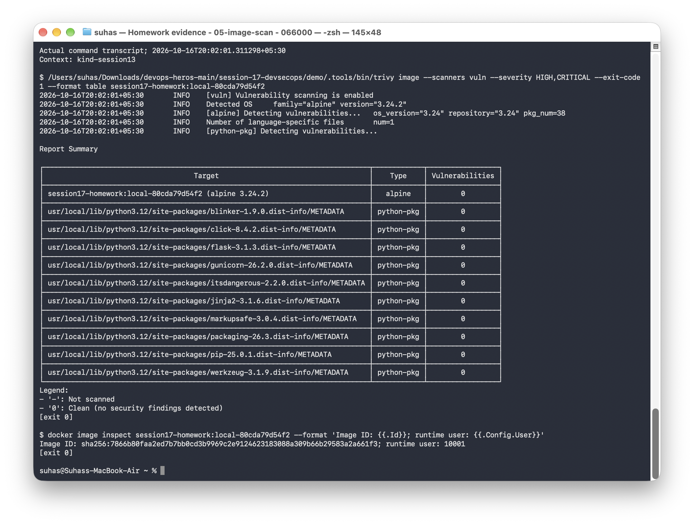
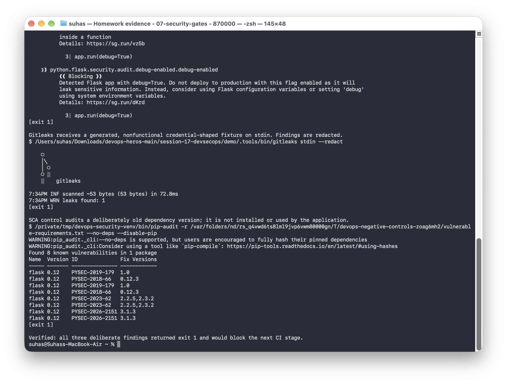
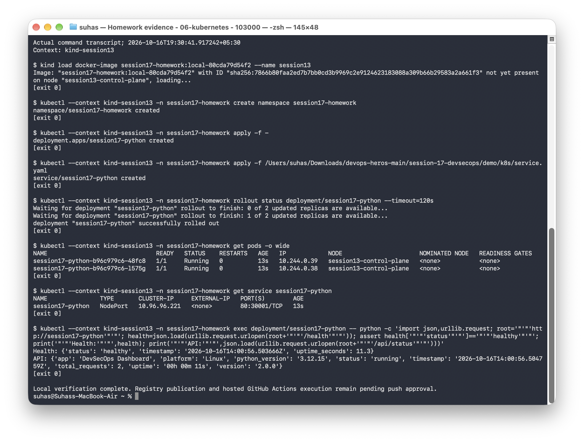
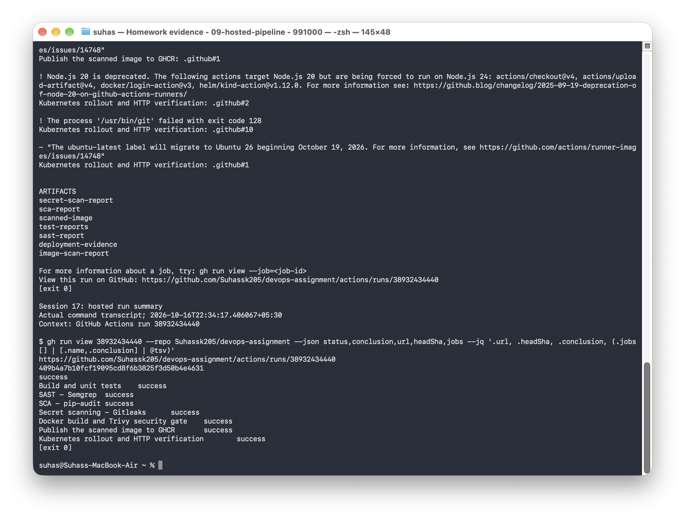
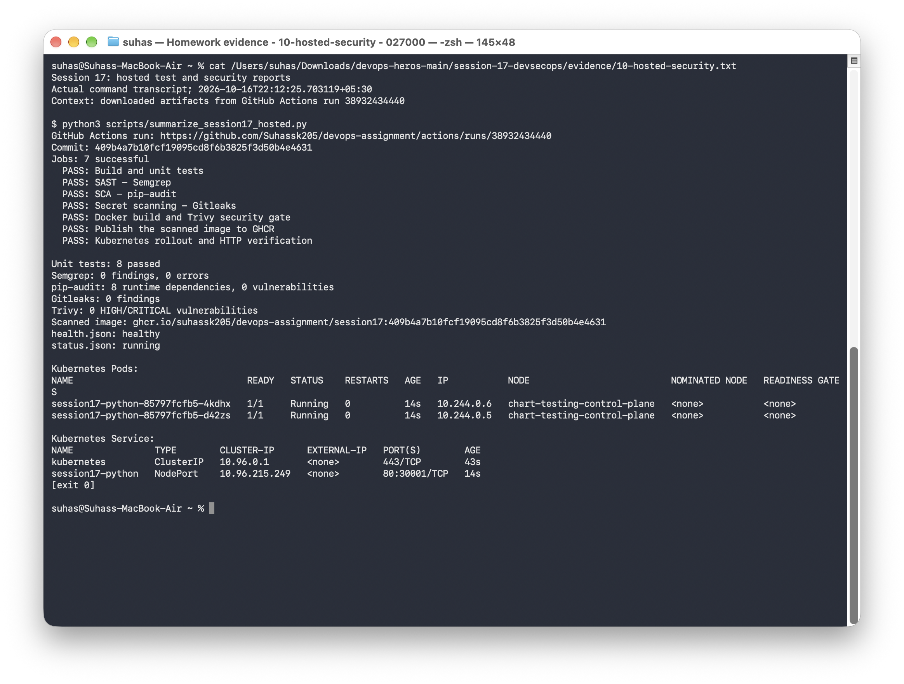

# Session 17: Complete CI/CD & DevSecOps

**Name:** Suhas

**Repository:** [devops-assignment](https://github.com/Suhassk205/devops-assignment)

This exercise uses a [Flask dashboard](demo/README.md) to practice unit testing, security scanning, container builds, and Kubernetes deployment. The project includes local checks and a GitHub Actions workflow for the same delivery stages.

## Application and delivery flow

```text
Flask dashboard -> build/tests -> Semgrep + pip-audit + Gitleaks
    -> Docker build -> Trivy gate -> preserve scanned image
    -> GHCR publication -> temporary Kind rollout -> live HTTP verification
```

The dashboard includes a pipeline simulator. Security checks run through the scanner tools and GitHub Actions workflow.

## Project files

| File or directory | Purpose |
|---|---|
| [Application](demo/app/) | Flask dashboard and health/status APIs |
| [Unit tests](demo/tests/test_app.py) | API, calculation, and response checks |
| [Dockerfile](demo/Dockerfile) | Container build with pinned base image and non-root Gunicorn runtime |
| [Workflow](../.github/workflows/session17-devsecops.yml) | Tests, security scans, image publication, and deployment |
| [Scanner installer](demo/scripts/install_scanners.py) | Pinned Trivy/Gitleaks downloads with checksum verification |
| [Gitleaks configuration](demo/.gitleaks.toml) | Secret-scanning rules |
| [Security notes](demo/SECURITY.md) | Tool choices and failure gates |
| [Deployment](demo/k8s/deployment.yaml) and [Service](demo/k8s/service.yaml) | Two application replicas, probes, resource limits, and service networking |

## Task 1: Application build and unit tests

From the repository root:

```bash
cd session-17-devsecops/demo
python3 -m venv .venv
source .venv/bin/activate
pip install -r requirements-dev.txt
python -m compileall -q app
pytest -v --cov=app --cov-report=term-missing
docker build -t session17-python:local .
```

Eight unit tests passed. The local coverage report showed 69% statement coverage. The Docker image runs Gunicorn as UID `10001`, with the Flask debugger disabled.

[Full test output](evidence/01-tests.txt) · [Docker build and scan output](evidence/05-image-scan.txt)



## Task 2: Security scans and failure gates

With the application environment active, these are the local scan commands:

```bash
pip install semgrep==1.181.0 pip-audit==2.10.1
python scripts/install_scanners.py
semgrep scan --config p/python --config p/javascript --error --metrics off app
pip-audit -r requirements.txt --strict
.tools/bin/gitleaks dir --redact .
.tools/bin/trivy image --scanners vuln --severity HIGH,CRITICAL --exit-code 1 session17-python:local
```

| Check | What it checks | Recorded result |
|---|---|---|
| SAST — Semgrep | Python and JavaScript source patterns | 0 findings and 0 scan errors |
| SCA — pip-audit | Known vulnerabilities in runtime dependencies | 8 dependencies; 0 known vulnerabilities |
| Secret scanning — Gitleaks | Credentials in source; application Git history in CI | 0 findings |
| Container scan — Trivy | HIGH/CRITICAL image vulnerabilities | 0 HIGH/CRITICAL vulnerabilities |

The image job depends on all source checks. Semgrep uses `--error`, and Trivy uses `--exit-code 1` for HIGH/CRITICAL findings. A failing scan stops publication and deployment.

I also checked the failure behavior with separate examples containing unsafe Flask code, a dummy credential, and an old dependency. Semgrep, Gitleaks, and pip-audit each returned exit code 1. Those examples were kept separate from the application.

[SAST output](evidence/02-sast.txt) · [Secret scan output](evidence/03-secret-scan.txt) · [SCA output](evidence/04-sca.txt) · [Failure-gate output](evidence/07-security-gates.txt)











## Task 3: Registry publication and Kubernetes deployment

The workflow builds the image once, scans it, and saves it as an artifact. The publication job loads that artifact and pushes the same image to GHCR with the source commit as its tag. Registry authentication uses GitHub's `GITHUB_TOKEN`.

The deployment job creates a temporary Kind cluster, pulls the published image, loads it into the cluster, and applies the manifests with that image tag. It then checks rollout, Pods, the Service, and HTTP responses. These are the main verification commands:

```bash
kubectl rollout status deployment/session17-python --timeout=180s
kubectl get pods -o wide
kubectl get service session17-python
```

Both replicas reached `1/1 Running` with zero restarts. The `/health` endpoint returned `healthy`, and `/api/status` returned `running`. The local run used namespace `session17-homework` on `kind-session13`; the hosted run used its own temporary cluster.

[Local deployment and HTTP output](evidence/06-kubernetes.txt) · [Hosted publication and deployment log](evidence/11-hosted-publication-deployment.txt)



## Task 4: Successful GitHub Actions run

The [complete pipeline run](https://github.com/Suhassk205/devops-assignment/actions/runs/38932434440) passed all seven jobs for commit `409b4a7b10fcf19095cd8f6b3825f3d50b4e4631`.

| Stage | Hosted result |
|---|---|
| Build and unit tests | 8 tests passed |
| Semgrep | 0 findings and 0 scan errors |
| pip-audit | 8 runtime dependencies audited; 0 known vulnerabilities |
| Gitleaks | 0 findings in the application’s Git history |
| Docker and Trivy | Image built; 0 HIGH/CRITICAL vulnerabilities |
| GHCR publication | Commit-tagged image published successfully |
| Kubernetes deployment | Two ready replicas; health and status endpoints passed |

Published image:

```text
ghcr.io/suhassk205/devops-assignment/session17:409b4a7b10fcf19095cd8f6b3825f3d50b4e4631
```

Registry digest: `sha256:bff16bb659ecb0ccf0403aabaac44f529e6cfd86420a7e827eb984e26b9cf20d`.

The [downloaded reports](evidence/hosted-reports/) contain the tests, scanner results, and deployment output. The published Trivy copy omits image build configuration; its scan results and image identity are unchanged. The complete original report is available in the run’s `image-scan-report` artifact.

## Local test results

| Stage | Tool / implementation | Result |
|---|---|---|
| Source build and tests | Python source parsing; pytest + coverage | 8 tests passed; 69% statement coverage |
| SAST | Semgrep 1.181.0, `p/python` and `p/javascript` | 0 findings, 0 scan errors |
| Secret scanning | Gitleaks 8.30.1, default rules, redacted output | 0 findings in the demo source tree |
| SCA | pip-audit 2.10.1, pinned runtime requirements | 8 runtime dependencies audited; 0 known vulnerabilities |
| Container build | Python 3.12 Alpine base pinned by digest; Gunicorn | Image built; runtime user is UID 10001 |
| Image scanning | Trivy 0.76.0, HIGH/CRITICAL, `--exit-code 1` | 0 HIGH/CRITICAL vulnerabilities; no ignore-unfixed exception |
| Kubernetes | Deployment, Service, health probes and resource limits | 2 ready replicas; live `/health` and `/api/status` checks succeeded |
| Gate enforcement | Isolated intentionally unsafe fixtures | Semgrep, Gitleaks and pip-audit each returned exit 1 as required |

Rerun the scans before deployment, since vulnerability databases change. The local Gitleaks check scans the demo working tree; the CI job scans the application’s Git history.

## Security changes

- Disabled Flask's development debugger; the container runs Gunicorn as a non-root user.
- Rendered the user-supplied pipeline branch with `textContent` instead of inserting it into HTML.
- Pinned runtime dependencies and the base image digest.
- Added an explicit secret-scanning job and strict vulnerability gates.
- Installed Trivy and Gitleaks from pinned official releases with SHA-256 verification.
- Configured readiness/liveness checks and restricted container privileges.

I also tested the security gates with separate examples containing debug-enabled Flask code, a dummy credential, and an old Flask dependency. Each scanner rejected its example with exit code 1. The redacted logs are linked below.

## GitHub Actions workflow

The [workflow](../.github/workflows/session17-devsecops.yml) triggers on pushes to `main`, pull requests, and manual dispatch. Its dependency graph blocks image creation until tests, SAST, SCA and secret scanning pass. Trivy scans the built image before any publication.

The scanned image is saved as a workflow artifact; the publication job loads that same artifact rather than rebuilding. Only a push to `main` publishes. The deployment job pulls the published commit-SHA tag, loads it into a temporary Kind cluster, waits for rollout, and checks HTTP responses. The Kind cluster is created for the CI job and removed when the job ends.

GHCR authentication uses `GITHUB_TOKEN`, with package permissions set on the publish and deploy jobs. Test, scan, and deployment reports are uploaded as artifacts. The workflow runs from this repository’s `.github/workflows/` directory and uses `session-17-devsecops/demo/` as its application directory. It publishes commit-tagged images to `ghcr.io/suhassk205/devops-assignment/session17`.

## Run the local checks

From `demo/`, prepare an isolated Python environment with the pinned requirements and scanner tools described in [the demo README](demo/README.md). From the course repository root:

```bash
python3 scripts/run_session17.py
python3 scripts/verify_security_gates.py
```

The local script deploys into `session17-homework` on `kind-session13`.

## Recorded evidence

The text files contain the full command output; the screenshots show the main results.

| Exercise | Full output | Terminal screenshot |
|---|---|---|
| Session 17 - pinned scanner versions | [Transcript](evidence/00-tools.txt) | [Screenshot](screenshots/00-tools.png) |
| Session 17 - build and unit test output | [Transcript](evidence/01-tests.txt) | [Screenshot](screenshots/01-tests.png) |
| SAST - Semgrep Python and JavaScript rules | [Transcript](evidence/02-sast.txt) | [Screenshot](screenshots/02-sast.png) |
| Secret scanning - Gitleaks scan of the demo source tree | [Transcript](evidence/03-secret-scan.txt) | [Screenshot](screenshots/03-secret-scan.png) |
| SCA - vulnerability audit of pinned runtime dependencies | [Transcript](evidence/04-sca.txt) | [Screenshot](screenshots/04-sca.png) |
| Docker build and Trivy HIGH/CRITICAL vulnerability gate | [Transcript](evidence/05-image-scan.txt) | [Screenshot](screenshots/05-image-scan.png) |
| Session 17 - local Kubernetes deployment and live HTTP checks | [Transcript](evidence/06-kubernetes.txt) | [Screenshot](screenshots/06-kubernetes.png) |
| Security gates - deliberately unsafe fixtures must be rejected | [Transcript](evidence/07-security-gates.txt) | [Screenshot](screenshots/07-security-gates.png) |
| Workflow validation and application-history secret scan | [Transcript](evidence/08-workflow-preflight.txt) | [Screenshot](screenshots/08-workflow-preflight.png) |
| Successful GitHub Actions pipeline | [Transcript](evidence/09-hosted-pipeline.txt) | [Screenshot](screenshots/09-hosted-pipeline.png) |
| Hosted tests, scans, and healthy Kubernetes Pods | [Transcript](evidence/10-hosted-security.txt) | [Screenshot](screenshots/10-hosted-security.png) |
| Registry publication and Kubernetes rollout | [Job output](evidence/11-hosted-publication-deployment.txt) | [Complete run log](evidence/12-hosted-run.log) |

### Hosted pipeline screenshots




