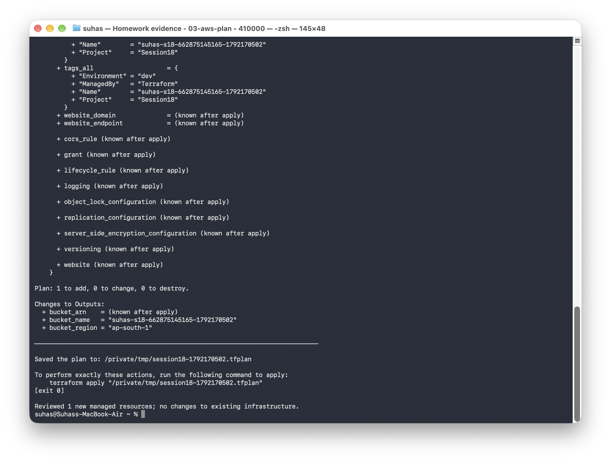
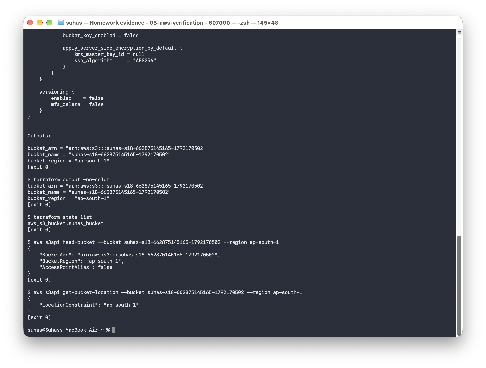
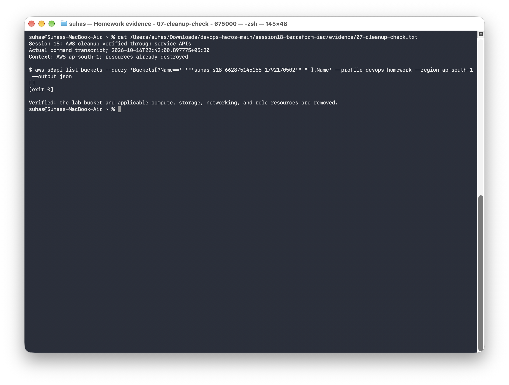

# Session 18: Terraform & Infrastructure as Code

**Name:** Suhas

**Repository:** [devops-assignment](https://github.com/Suhassk205/devops-assignment)

This homework has two parts: creating and removing an S3 bucket with Terraform, and researching the AWS services used in a cloud application. I ran the S3 exercise in `ap-south-1` and removed the bucket after checking its state and outputs.

## Task 1: Terraform S3 bucket

### Project files

The configuration is in [terraform-s3-demo/](terraform-s3-demo/README.md).

| File | Purpose |
|---|---|
| [terraform.tf](terraform-s3-demo/terraform.tf) | Terraform and AWS provider requirements |
| [providers.tf](terraform-s3-demo/providers.tf) | AWS provider configuration |
| [main.tf](terraform-s3-demo/main.tf) | S3 bucket resource and tags |
| [variables.tf](terraform-s3-demo/variables.tf) | Bucket name and AWS region |
| [outputs.tf](terraform-s3-demo/outputs.tf) | Bucket name, ARN, and region |
| [terraform.tfvars.example](terraform-s3-demo/terraform.tfvars.example) | Example input values |

The working variable file, state files, and saved plans are excluded from Git. AWS credentials come from the signed-in CLI profile.

```text
Terraform files -> AWS provider -> S3 bucket
                        |
                 state and outputs
```

### Initialize, format, validate, and plan

From the repository root, the workflow is:

```bash
cd session18-terraform-iac/terraform-s3-demo
export AWS_PROFILE=devops-homework
aws sts get-caller-identity
cp terraform.tfvars.example terraform.tfvars
# Set a unique bucket name and the region in terraform.tfvars.
terraform init
terraform fmt
terraform fmt -check -recursive
terraform validate
terraform plan -out=deployment.tfplan
```

Initialization succeeded, validation passed, and the plan proposed one new bucket without changing any existing resources. The bucket used for this run was `suhas-s18-662875145165-1792170502`.

```text
Success! The configuration is valid.
Plan: 1 to add, 0 to change, 0 to destroy.
```

[Full initialization and plan output](evidence/03-aws-plan.txt)



### Apply the plan

```bash
terraform apply deployment.tfplan
```

Terraform created the bucket and returned its name, ARN, and region.

```text
Apply complete! Resources: 1 added, 0 changed, 0 destroyed.
```

[Full apply output](evidence/04-aws-apply.txt)


### Inspect state, outputs, and the bucket

```bash
terraform show
terraform state list
terraform state show aws_s3_bucket.suhas_bucket
terraform output
aws s3api head-bucket --bucket "$(terraform output -raw bucket_name)"
aws s3api get-bucket-location --bucket "$(terraform output -raw bucket_name)"
```

The state contained `aws_s3_bucket.suhas_bucket`. AWS checks confirmed the bucket was reachable in `ap-south-1`.

| Output | Recorded value |
|---|---|
| Bucket name | `suhas-s18-662875145165-1792170502` |
| Bucket ARN | `arn:aws:s3:::suhas-s18-662875145165-1792170502` |
| Region | `ap-south-1` |

[Full state, output, and AWS verification](evidence/05-aws-verification.txt)



### Destroy and verify cleanup

```bash
terraform plan -destroy
terraform destroy
terraform state list
```

Terraform destroyed the bucket, and the state listing was empty afterward. I also checked the AWS bucket listing; it returned no match for the lab bucket. The bucket is no longer present.

```text
Destroy complete! Resources: 1 destroyed.
```

[Destroy output](evidence/06-aws-destroy.txt) · [AWS cleanup check](evidence/07-cleanup-check.txt)




## Task 2: AWS services research

Each service has its own README with examples, common use cases, and links to the AWS documentation.

| Research notes | Topics covered |
|---|---|
| [01 — IAM](aws-services/01-iam/README.md) | Users, groups, roles, policies, permissions, least privilege, best practices, and use cases |
| [02 — EC2](aws-services/02-ec2/README.md) | AMIs, instance types, key pairs, Security Groups, EBS, public/private IPs, lifecycle, and use cases |
| [03 — S3](aws-services/03-s3/README.md) | Buckets, objects, storage classes, versioning, lifecycle policies, encryption, bucket policies, and use cases |
| [04 — VPC](aws-services/04-vpc/README.md) | CIDR, subnets, route tables, Internet/NAT Gateways, Security Groups, network ACLs, and public/private subnets |
| [05 — DynamoDB and RDS](aws-services/05-dynamodb-rds/README.md) | NoSQL tables/items/attributes/keys; relational engines, DB instances, security, backups, Multi-AZ, read replicas, and use cases |

The [research index](aws-services/README.md) connects these services to a typical web application. IAM controls access, EC2 runs the application, VPC defines its network, S3 stores objects, and the database choice depends on the data model and access patterns.

## Topics

- [Infrastructure as Code basics](01-iac-basics/README.md)
- [Terraform architecture](02-terraform-architecture/README.md)
- [Providers](03-providers/README.md)
- [Resources](04-resources/README.md)
- [Variables](05-variables/README.md)
- [Outputs](06-outputs/README.md)
- [Initialize, plan, and apply](07-init-plan-apply/README.md)
- [Destroy resources](08-destroy/README.md)
- [Terraform state](09-state/README.md)
- [S3 bucket example](terraform-s3-demo/)

## Setup references

- [Install Terraform](https://developer.hashicorp.com/terraform/tutorials/aws-get-started/install-cli)
- [Terraform AWS tutorial](https://developer.hashicorp.com/terraform/tutorials/aws-get-started/aws-create)
- [Install the AWS CLI](https://docs.aws.amazon.com/cli/latest/userguide/getting-started-install.html)

## What I learned

The plan shows what Terraform intends to change; applying it creates the resources. State connects the configuration to the real bucket, and destroying the project removes the resource while updating that state.
