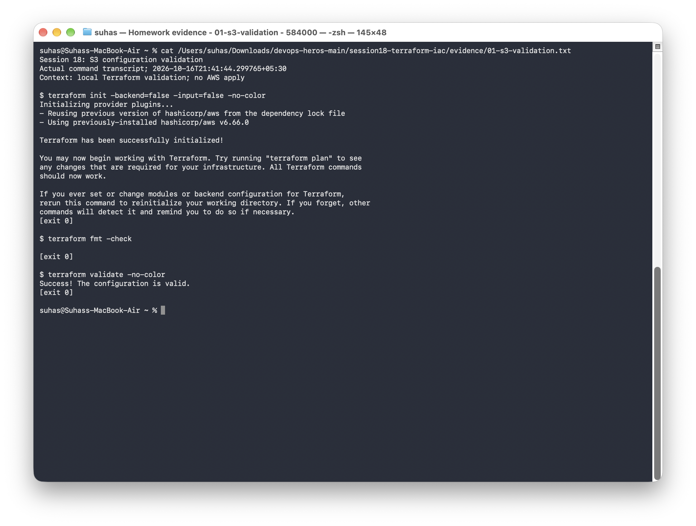
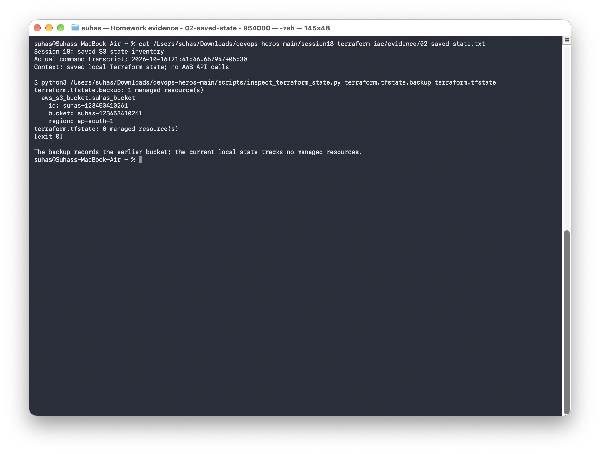

# Terraform S3 bucket demo

This exercise uses one S3 bucket to practice Terraform initialization, planning, resource creation, state inspection, outputs, and cleanup.

## Files

- [terraform.tf](terraform.tf): Terraform and AWS provider requirements.
- [providers.tf](providers.tf): AWS provider configuration.
- [variables.tf](variables.tf): region and bucket name.
- [main.tf](main.tf): the `aws_s3_bucket.suhas_bucket` resource.
- [outputs.tf](outputs.tf): bucket name, ARN, and region.
- [terraform.tfvars.example](terraform.tfvars.example): example input values.

```text
Terraform configuration -> AWS provider -> S3 bucket
                                  |
                         state and outputs
```

## Configure inputs

```bash
cp terraform.tfvars.example terraform.tfvars
```

Choose a unique lowercase bucket name in `terraform.tfvars`. Use your normal AWS CLI profile for credentials; the variable file holds project settings, not access keys.

## Terraform lifecycle

Run from this directory with a working AWS sign-in:

```bash
aws sts get-caller-identity
terraform init
terraform fmt
terraform validate
terraform plan -out=deployment.tfplan
terraform apply deployment.tfplan
terraform show
terraform state list
terraform state show aws_s3_bucket.suhas_bucket
terraform output
```

The plan should propose the bucket before it is created. After applying, the bucket appears in state and the output commands return its name, ARN, and region. To check that the bucket is reachable with the current identity:

```bash
aws s3api head-bucket --bucket "$(terraform output -raw bucket_name)"
```

## Cleanup

```bash
terraform plan -destroy
terraform destroy
terraform state list
```

The resource uses `force_destroy = true` for this disposable exercise, so destruction also removes any objects in the bucket. Check the selected bucket before approving deletion.

## Local checks and saved state

The configuration passes `terraform fmt -check` and `terraform validate`. The saved backup contains `suhas-123453410261` in `ap-south-1`; the current local state contains no managed resources. The inventory below reads those local files without making AWS API calls.

- [Initialization and configuration validation](../evidence/01-s3-validation.txt)
- [Saved-state inventory](../evidence/02-saved-state.txt)





State and backup files stay outside Git because they can contain sensitive resource information. The command output records the small inventory needed for the exercise.
