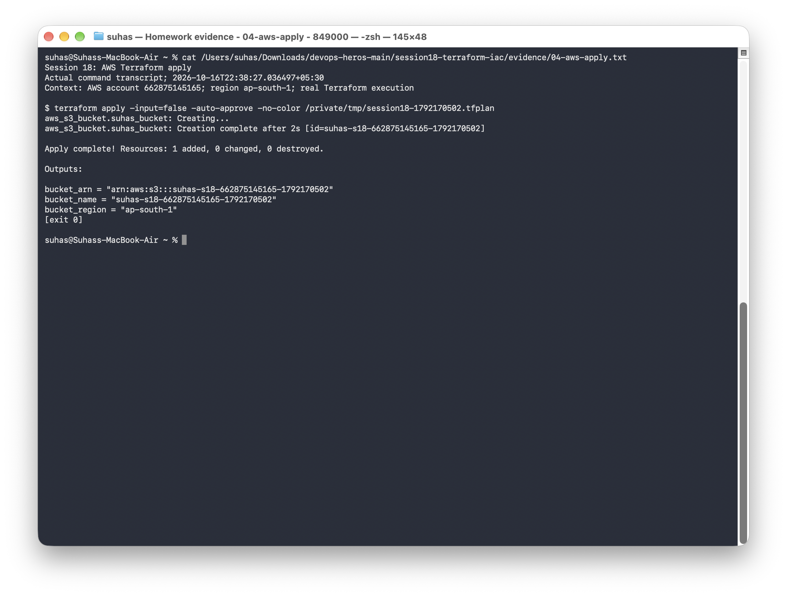
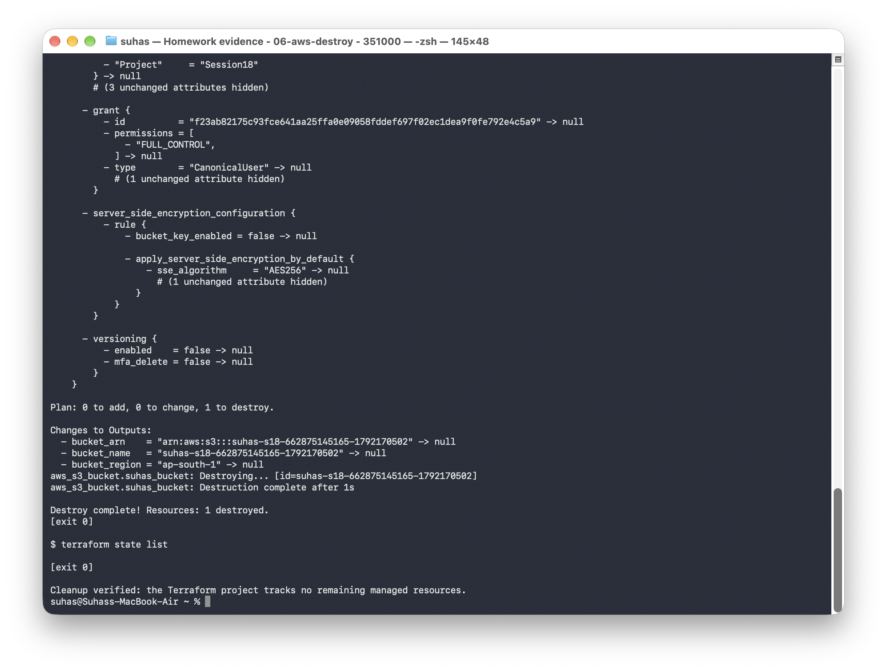

# Terraform S3 bucket demo

This exercise uses one S3 bucket to practice Terraform initialization, planning, resource creation, state inspection, outputs, and cleanup.

## Files

- [terraform.tf](terraform.tf): Terraform and AWS provider requirements.
- [providers.tf](providers.tf): AWS provider configuration.
- [variables.tf](variables.tf): region and bucket name.
- [main.tf](main.tf): the `aws_s3_bucket.suhas_bucket` resource.
- [outputs.tf](outputs.tf): bucket name, ARN, and region.
- [terraform.tfvars.example](terraform.tfvars.example): example input values.

```text
Terraform configuration -> AWS provider -> S3 bucket
                                  |
                         state and outputs
```

## Configure inputs

```bash
cp terraform.tfvars.example terraform.tfvars
```

Choose a unique lowercase bucket name in `terraform.tfvars`. Use your normal AWS CLI profile for credentials; the variable file holds project settings, not access keys.

## Terraform lifecycle

Run from this directory with a working AWS sign-in:

```bash
aws sts get-caller-identity
terraform init
terraform fmt
terraform validate
terraform plan -out=deployment.tfplan
terraform apply deployment.tfplan
terraform show
terraform state list
terraform state show aws_s3_bucket.suhas_bucket
terraform output
```

The plan should propose the bucket before it is created. After applying, the bucket appears in state and the output commands return its name, ARN, and region. To check that the bucket is reachable with the current identity:

```bash
aws s3api head-bucket --bucket "$(terraform output -raw bucket_name)"
```

## Cleanup

```bash
terraform plan -destroy
terraform destroy
terraform state list
```

The resource uses `force_destroy = true` for this disposable exercise, so destruction also removes any objects in the bucket. Check the selected bucket before approving deletion.

## AWS workflow results

I ran the complete workflow in `ap-south-1` using bucket `suhas-s18-662875145165-1792170502`.

| Step | Result |
|---|---|
| Initialize, format, validate | Passed |
| Plan | 1 bucket to create |
| Apply | 1 bucket created |
| Show and output | Bucket name, ARN, region, and state inspected |
| AWS verification | Bucket reachable; location confirmed as `ap-south-1` |
| Destroy | 1 resource destroyed; local state empty |
| Cleanup check | AWS bucket listing confirms the lab bucket is absent |

The run used a unique bucket-name variable to avoid collisions with other exercises. The bucket was removed after verification.

## Command output and screenshots

| Exercise | Full output | Screenshot |
|---|---|---|
| Initialization, formatting, validation, and plan | [Output](../evidence/03-aws-plan.txt) | [Screenshot](../screenshots/03-aws-plan.png) |
| Create the S3 bucket | [Output](../evidence/04-aws-apply.txt) | [Screenshot](../screenshots/04-aws-apply.png) |
| Inspect state, outputs, and AWS bucket location | [Output](../evidence/05-aws-verification.txt) | [Screenshot](../screenshots/05-aws-verification.png) |
| Destroy and check empty Terraform state | [Output](../evidence/06-aws-destroy.txt) | [Screenshot](../screenshots/06-aws-destroy.png) |
| Confirm removal through the AWS API | [Output](../evidence/07-cleanup-check.txt) | [Screenshot](../screenshots/07-cleanup-check.png) |





State and backup files stay outside Git because they can contain sensitive resource information. The command output records the results needed for the exercise.
