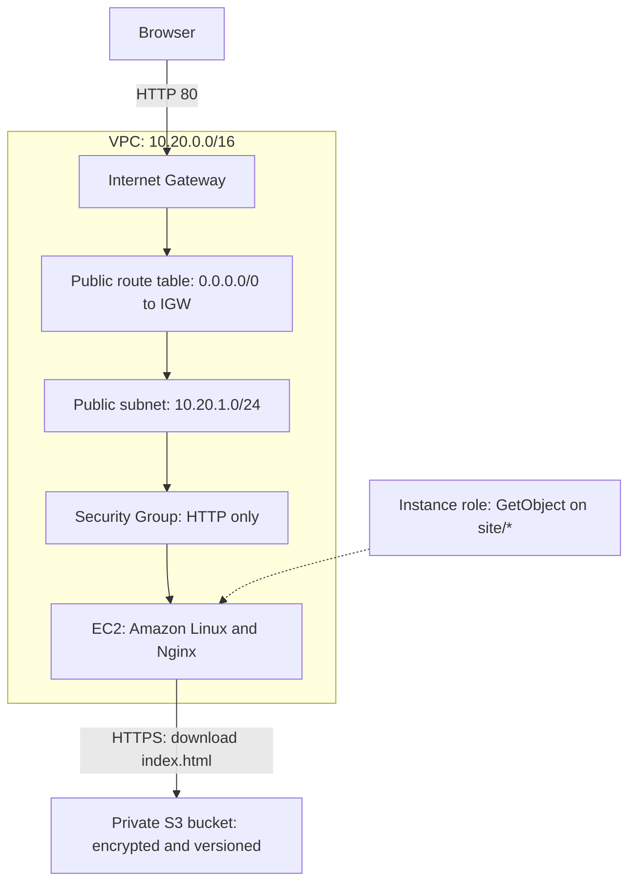
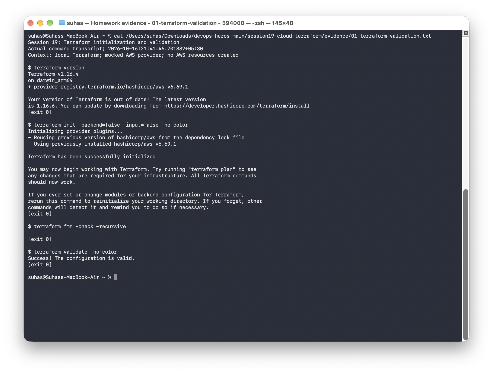

# Session 19 mini-project: EC2 website with private S3 artifacts

This project defines a small AWS web application with Terraform. An EC2 instance runs Nginx in a public subnet. Its instance role downloads the website from a private S3 bucket, so the server needs no stored AWS access keys.

## Architecture



S3 is a regional service outside the VPC. The instance reaches its API through the public subnet's outbound internet route. The bucket is private even though Nginx serves the downloaded page publicly.

## Terraform files

| File | Purpose |
|---|---|
| [versions.tf](versions.tf) | Terraform version, AWS provider, and region |
| [variables.tf](variables.tf) | Region, project prefix, instance size, optional AMI, and HTTP client CIDR |
| [main.tf](main.tf) | Network, EC2, IAM role/profile, S3 bucket protections, and website object |
| [outputs.tf](outputs.tf) | VPC, subnet, instance, bucket, and website outputs |
| [terraform.tfvars.example](terraform.tfvars.example) | Example settings without credentials |
| [user-data.sh.tftpl](user-data.sh.tftpl) | Install Nginx, download the private object, and start the service |
| [site/index.html](site/index.html) | Website content stored in S3 |
| [tests/architecture.tftest.hcl](tests/architecture.tftest.hcl) | Local plan, connection, security, and invalid-input tests |

Terraform resource references establish the dependencies. The instance also explicitly waits for the route association, object upload, and role policy before bootstrapping.

## Security choices

- The instance accepts HTTP on port 80 from `http_allowed_cidr`; SSH is closed.
- IMDSv2 is required, and the root EBS volume is encrypted.
- The instance role can read only `site/*` in this project's bucket.
- S3 public access is blocked, object ownership is enforced, and versioning is enabled.
- Bucket encryption uses AES256, and the bucket policy denies requests without secure transport.
- Terraform state, private variable files, and saved plans are excluded from Git.

HTTP is used for the classroom web page. HTTPS would need a certificate and a suitable TLS termination setup.

## Local verification

I initialized the provider, checked formatting, validated the configuration, and ran six Terraform tests. The tests use a **mocked AWS provider**: their plan, apply, and teardown operations happen in the test environment without creating cloud resources.

| Test | Result |
|---|---|
| Configuration plan | Passed |
| Subnet, routes, Security Group, and instance connections | Passed |
| Private, versioned, encrypted artifact storage | Passed |
| Instance permissions, IMDSv2, encrypted disk, and bootstrap content | Passed |
| Invalid project name rejected | Passed |
| Invalid HTTP client CIDR rejected | Passed |

The mock tests use a fixture AMI and generated resource IDs. They check the configuration's relationships and safeguards; live AWS permissions, AMI availability, and the running Nginx service need a deployment check.

Run from this directory:

```bash
terraform init -backend=false
terraform fmt -check -recursive
terraform validate
terraform test
terraform test -verbose
```

Or run `python3 scripts/run_session19.py` from the course repository root to save the output under `evidence/`.

## AWS deployment commands

Use a signed-in AWS CLI profile with the required permissions. Copy the example variables and review the plan before applying:

```bash
cp terraform.tfvars.example terraform.tfvars
aws sts get-caller-identity
terraform init
terraform fmt -check -recursive
terraform validate
terraform plan -out=deployment.tfplan
terraform apply deployment.tfplan
terraform show
terraform output
```

If `ami_id` is unset, Terraform resolves Amazon Linux 2023's x86_64 AMI through AWS's public SSM parameter. An explicit AMI must be valid in the selected region. Wait for the instance's bootstrap to finish before checking its URL:

```bash
curl --fail "$(terraform output -raw web_url)"
aws s3api get-public-access-block --bucket "$(terraform output -raw artifact_bucket)"
aws s3api get-bucket-versioning --bucket "$(terraform output -raw artifact_bucket)"
```

For a failed web response, inspect routes, Security Groups, instance status, and `/var/log/cloud-init-output.log`. Terraform creating an instance does not by itself confirm that Nginx started successfully.

## Cleanup

```bash
terraform plan -destroy
terraform destroy
terraform state list
```

The artifact bucket has `force_destroy = true` for this disposable lab. Destroying it removes its objects and versions too. The instance's root disk is configured for deletion at termination. Keep any required files elsewhere before cleanup.

## Command output and screenshots

- [Initialization, formatting, and validation](../evidence/01-terraform-validation.txt)
- [Six passing local tests](../evidence/02-terraform-tests.txt)
- [Full mocked plan and test output](../evidence/03-mocked-plan.txt)




