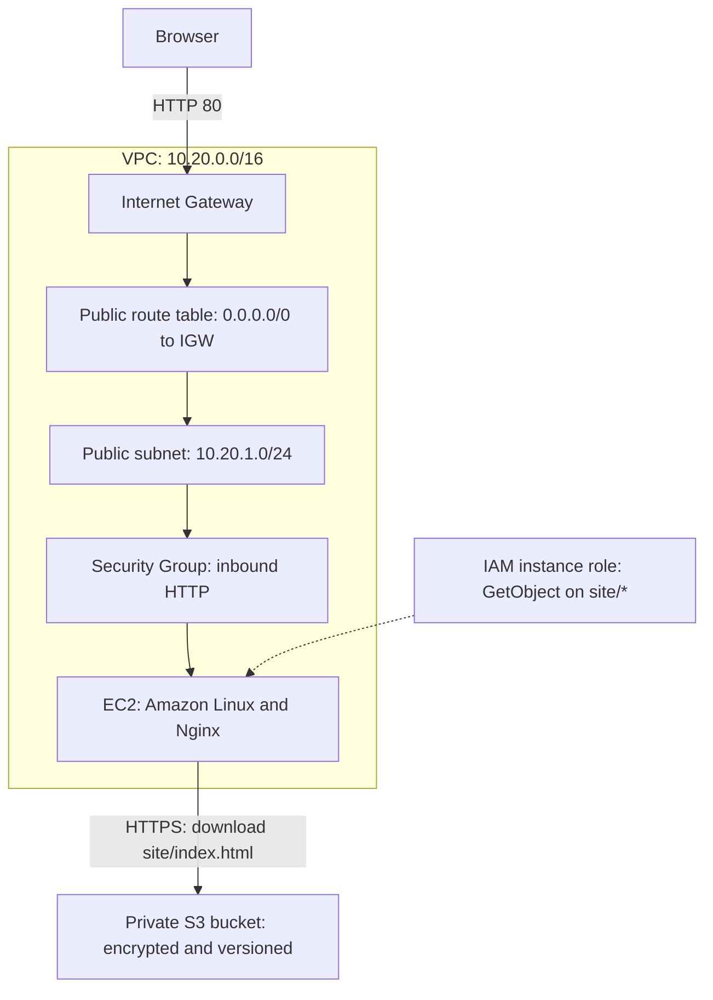
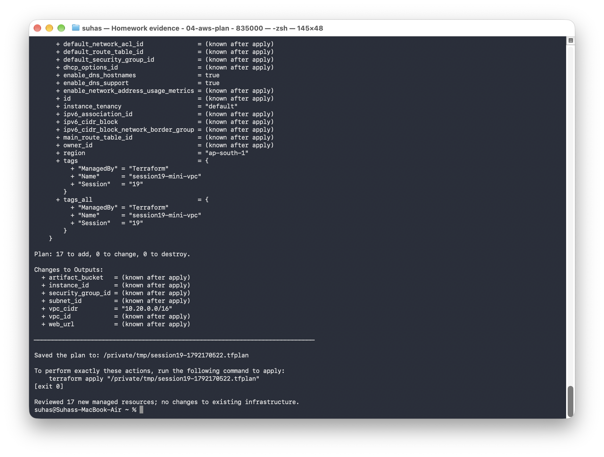
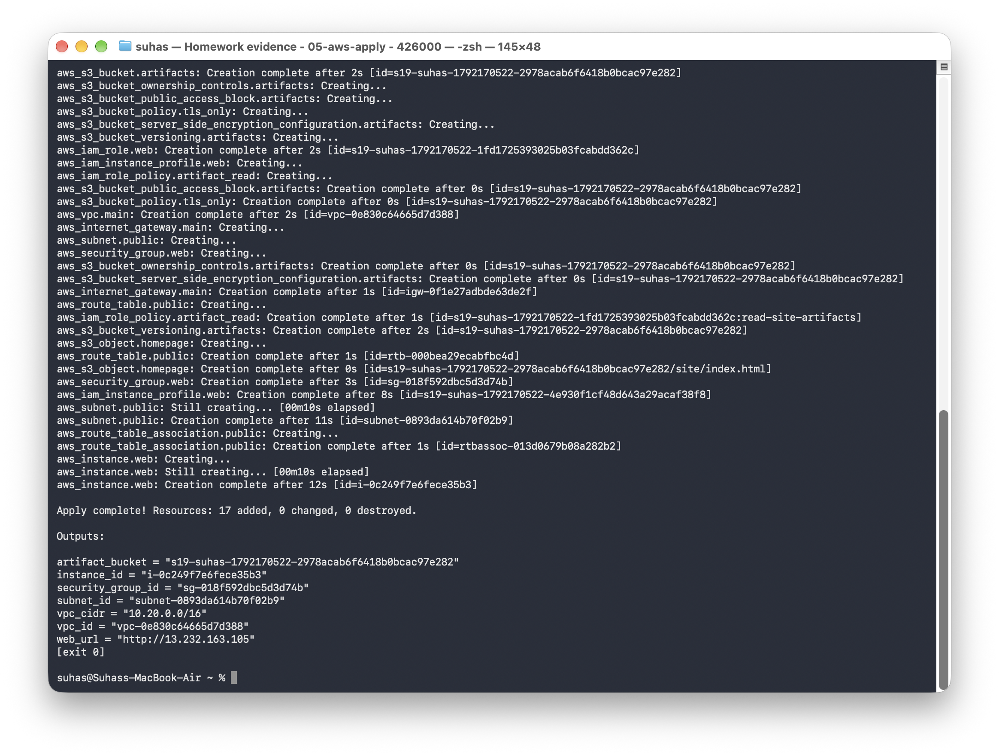
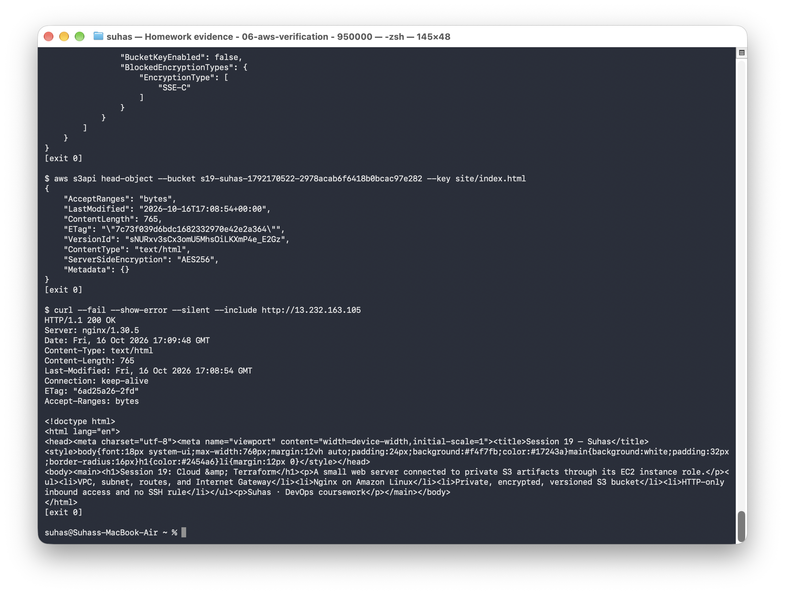
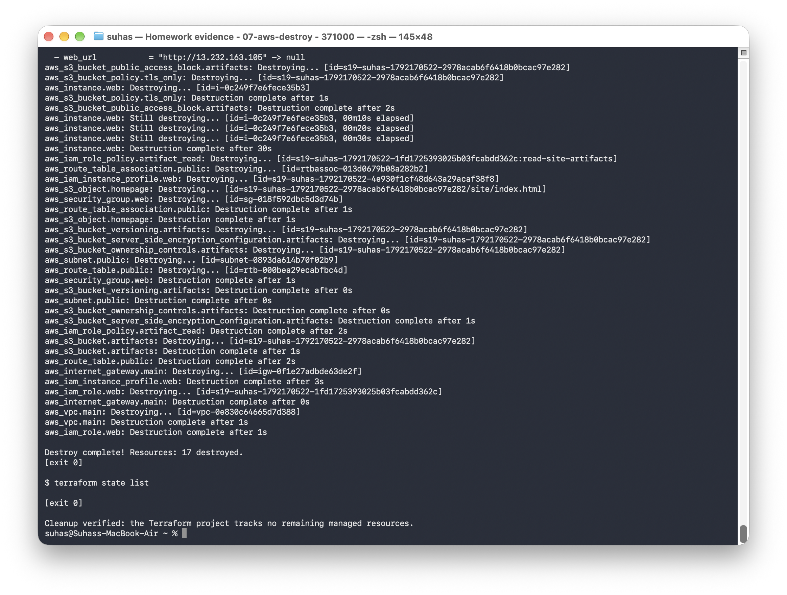
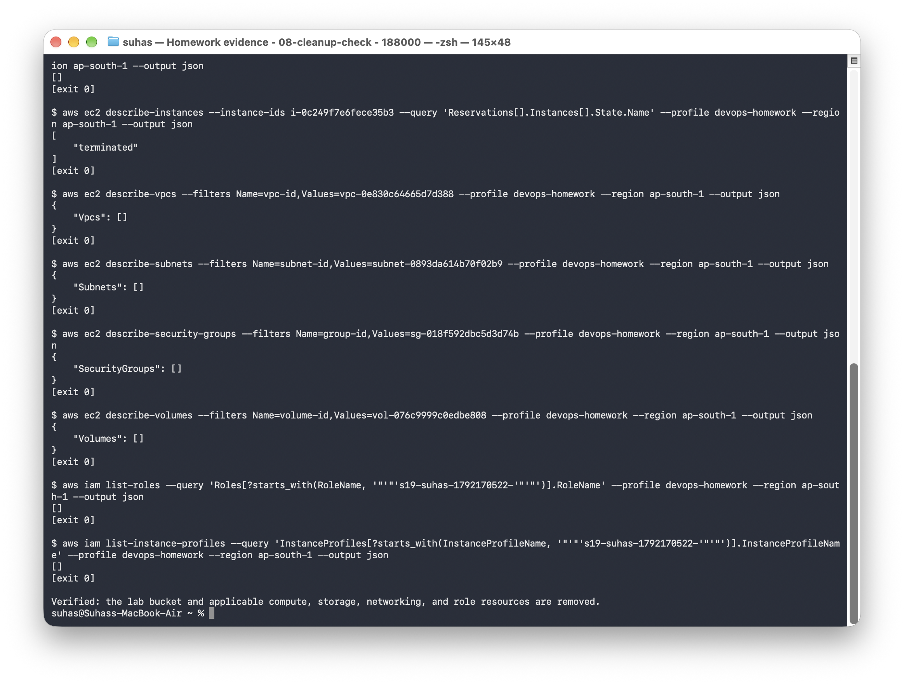
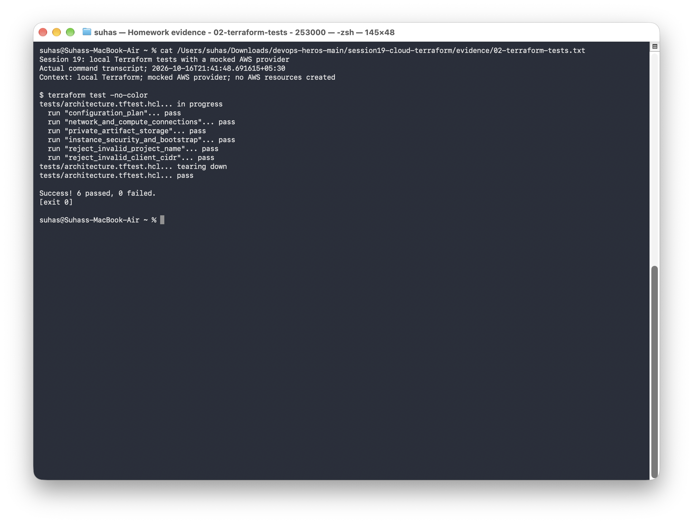

# Session 19: Cloud and Terraform in Action

**Name:** Suhas

**Repository:** [devops-assignment](https://github.com/Suhassk205/devops-assignment)

I used Terraform to deploy an Nginx website on EC2 in a public subnet. The instance downloaded the website from a private S3 bucket using its IAM role. After verifying the HTTP response and bucket settings, I destroyed the infrastructure and checked that the lab resources had been removed.

## Project and architecture

The complete configuration is in [08-mini-project/](08-mini-project/README.md).



S3 is a regional service outside the VPC. The instance uses the subnet's internet route to reach S3. The bucket remains private; Nginx serves the downloaded page over HTTP.

| Project file | Purpose |
|---|---|
| [versions.tf](08-mini-project/versions.tf) | Terraform requirements, AWS provider, and region |
| [variables.tf](08-mini-project/variables.tf) | Project name, region, instance type, AMI override, and HTTP client CIDR |
| [main.tf](08-mini-project/main.tf) | VPC, subnet, routes, Internet Gateway, Security Group, EC2, IAM, and S3 resources |
| [outputs.tf](08-mini-project/outputs.tf) | Resource IDs, bucket name, VPC CIDR, and website URL |
| [terraform.tfvars.example](08-mini-project/terraform.tfvars.example) | Example settings |
| [user-data.sh.tftpl](08-mini-project/user-data.sh.tftpl) | Install Nginx, download the website from S3, and start the service |
| [site/index.html](08-mini-project/site/index.html) | Website uploaded to S3 |
| [tests/architecture.tftest.hcl](08-mini-project/tests/architecture.tftest.hcl) | Local Terraform tests |

Resource references connect the VPC, subnet, routes, Security Group, instance role, and bucket. Explicit dependencies make the instance wait for the route association, uploaded website, and role policy before bootstrapping.

## Task 1: Initialize, validate, and plan

From the repository root:

```bash
cd session19-cloud-terraform/08-mini-project
export AWS_PROFILE=devops-homework
aws sts get-caller-identity
cp terraform.tfvars.example terraform.tfvars
# Set the project name, region, and HTTP client CIDR in terraform.tfvars.
terraform init
terraform fmt -check -recursive
terraform validate
terraform plan -out=deployment.tfplan
```

Validation passed. The AWS plan proposed 17 new managed resources, with no changes to existing infrastructure. If no AMI is supplied, the configuration resolves Amazon Linux 2023's x86_64 image through AWS's public SSM parameter.

```text
Plan: 17 to add, 0 to change, 0 to destroy.
```

[Full initialization and plan output](evidence/04-aws-plan.txt)



## Task 2: Apply and inspect the infrastructure

```bash
terraform apply deployment.tfplan
terraform show
terraform output
terraform state list
```

```text
Apply complete! Resources: 17 added, 0 changed, 0 destroyed.
```

The deployment ran in `ap-south-1`. These IDs identify the resources from that completed run:

| Resource | Recorded value |
|---|---|
| VPC | `vpc-0e830c64665d7d388` |
| Public subnet | `subnet-0893da614b70f02b9` |
| Security Group | `sg-018f592dbc5d3d74b` |
| EC2 instance | `i-0c249f7e6fece35b3`, `t3.micro` |
| S3 artifact bucket | `s19-suhas-1792170522-2978acab6f6418b0bcac97e282` |
| Website address during verification | `http://13.232.163.105` |

[Full apply output](evidence/05-aws-apply.txt)



## Task 3: Verify the website and storage settings

```bash
curl --fail --show-error --include "$(terraform output -raw web_url)"
aws s3api get-public-access-block --bucket "$(terraform output -raw artifact_bucket)"
aws s3api get-bucket-versioning --bucket "$(terraform output -raw artifact_bucket)"
aws s3api get-bucket-encryption --bucket "$(terraform output -raw artifact_bucket)"
aws s3api head-object --bucket "$(terraform output -raw artifact_bucket)" --key site/index.html
```

The EC2 instance reached `running`, Nginx returned `HTTP/1.1 200 OK`, and the response contained the Session 19 website. S3 checks confirmed that the website object existed, public access was blocked, versioning was enabled, and encryption used AES256.

The Security Group allowed inbound HTTP on port 80 with no SSH rule. The instance required IMDSv2, used an encrypted root volume, and received permission to read only `site/*` in the project's bucket.

[Full state, AWS settings, and HTTP response](evidence/06-aws-verification.txt)



## Task 4: Destroy and verify cleanup

```bash
terraform plan -destroy
terraform destroy
terraform state list
```

```text
Destroy complete! Resources: 17 destroyed.
```

The final Terraform state was empty. AWS checks confirmed the instance was terminated and the lab bucket, VPC, subnet, Security Group, EBS volume, IAM role, and instance profile had been removed. The recorded website address is no longer serving this project.

[Full destroy output](evidence/07-aws-destroy.txt) · [AWS cleanup checks](evidence/08-cleanup-check.txt)





## Local Terraform tests

Before the AWS deployment, I ran six tests using a mocked AWS provider. These test the configuration without provisioning cloud resources; the AWS screenshots above record the separate live deployment.

| Test | Result |
|---|---|
| Configuration plan | Passed |
| Subnet, routes, Security Group, and instance connections | Passed |
| Private, versioned, encrypted S3 storage | Passed |
| Instance permissions, IMDSv2, encrypted disk, and bootstrap | Passed |
| Invalid project name rejected | Passed |
| Invalid HTTP client CIDR rejected | Passed |

```bash
terraform test
terraform test -verbose
```

[Validation output](evidence/01-terraform-validation.txt) · [Test results](evidence/02-terraform-tests.txt) · [Full mocked plan](evidence/03-mocked-plan.txt)



## Topics

- [Cloud service models](01-cloud-service-models/README.md)
- [Regions and Availability Zones](02-regions-and-availability-zones/README.md)
- [VPCs and subnets](03-vpc-and-subnets/README.md)
- [Route tables and Internet Gateway](04-route-tables-and-internet-gateway/README.md)
- [Security groups](05-security-groups/README.md)
- [Terraform VPC example](06-terraform-vpc/README.md)
- [Terraform workflow](07-terraform-workflow/README.md)
- [Mini-project](08-mini-project/README.md)

## What I learned

This exercise connected the networking and storage pieces into a working application. Terraform tracked their dependencies and state; the HTTP and AWS checks verified the result before cleanup.
