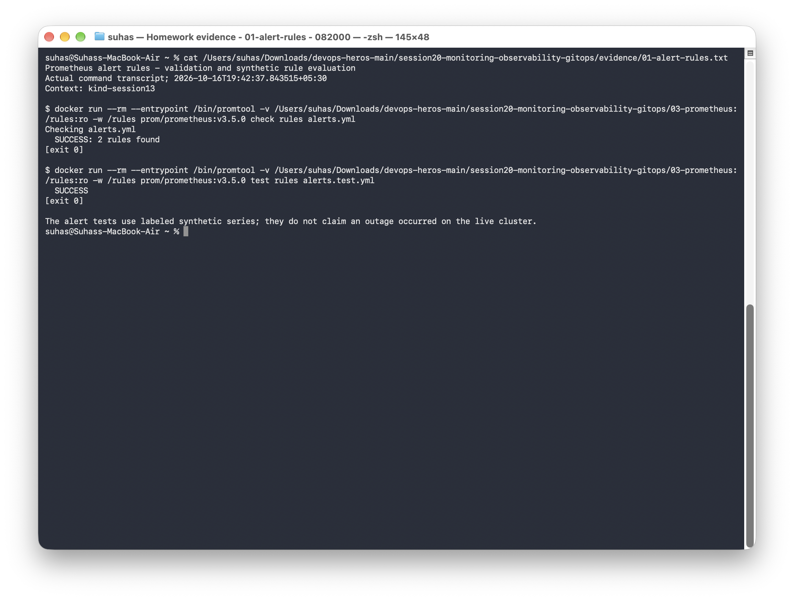
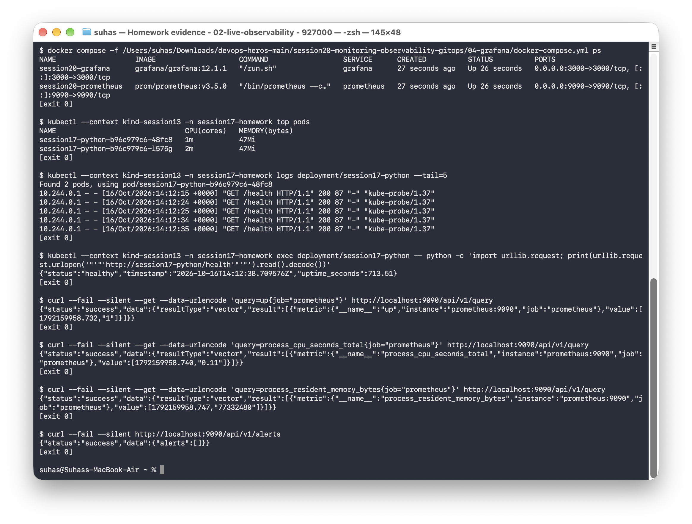

# Session 20: Monitoring, Observability & GitOps

These exercises cover Prometheus metrics, Grafana dashboards, alert rules, and GitOps deployments with ArgoCD.

## Task 1: Monitoring with Prometheus & Grafana
I deployed Prometheus and configured Grafana to visualize its metrics.

### Prometheus Up and Running


### Grafana Datasource Configuration


## Task 2: GitOps with ArgoCD
I used ArgoCD to sync application manifests from Git to the Kubernetes cluster.

### ArgoCD Dashboard Initialized


### Application Synced via GitOps


## CPU, memory, and health checks

I ran the Prometheus/Grafana Compose stack locally. Prometheus returned `up=1`, CPU-time and resident-memory samples, and no active alerts. I also checked the application’s CPU and memory usage, access logs, and HTTP health response through Kubernetes.

The Compose configuration scrapes Prometheus itself. The application resource usage and logs shown below come from `kubectl top` and `kubectl logs`.

The [alert rules](03-prometheus/alerts.yml) cover a scrape target being unavailable for 30 seconds and resident memory exceeding 256 MiB for two minutes. I validated the rules with Promtool and tested their pending and firing states using [synthetic metric samples](03-prometheus/alerts.test.yml).

| Signal | Meaning | Demo / common tooling |
|---|---|---|
| Metrics | Numeric measurements over time | Prometheus; CPU and memory queries; `kubectl top` |
| Logs | Individual recorded events | Gunicorn access logs; Loki or Elasticsearch are common aggregation options |
| Traces | A request's path and timings across services | Conceptual walkthrough in the linked lesson; OpenTelemetry/Jaeger are common tools |

[Metrics, logs and traces notes](02-metrics-logs-traces/README.md) explain why the signals complement each other. [GitOps notes](05-introduction-to-gitops/README.md), [Git as source of truth](06-git-as-source-of-truth/README.md), and [Argo CD reconciliation](07-argocd/README.md) document the declarative workflow.

```bash
docker compose -f 04-grafana/docker-compose.yml up -d
# Run from this session directory:
docker run --rm --entrypoint /bin/promtool -v "$PWD/03-prometheus:/rules:ro" -w /rules prom/prometheus:v3.5.0 check rules alerts.yml
docker run --rm --entrypoint /bin/promtool -v "$PWD/03-prometheus:/rules:ro" -w /rules prom/prometheus:v3.5.0 test rules alerts.test.yml
```

- [Alert validation and rule-test transcript](evidence/01-alert-rules.txt)
- [Metrics, logs and health transcript](evidence/02-live-observability.txt)



