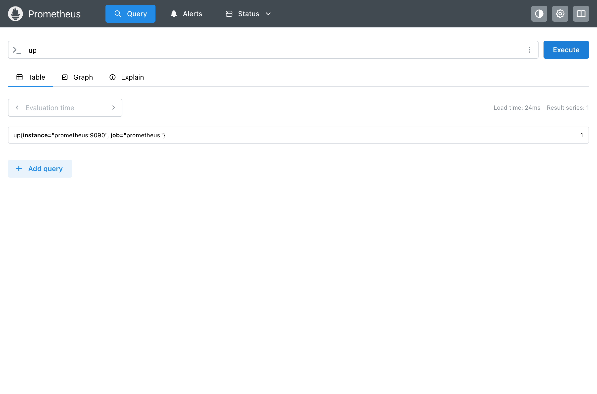
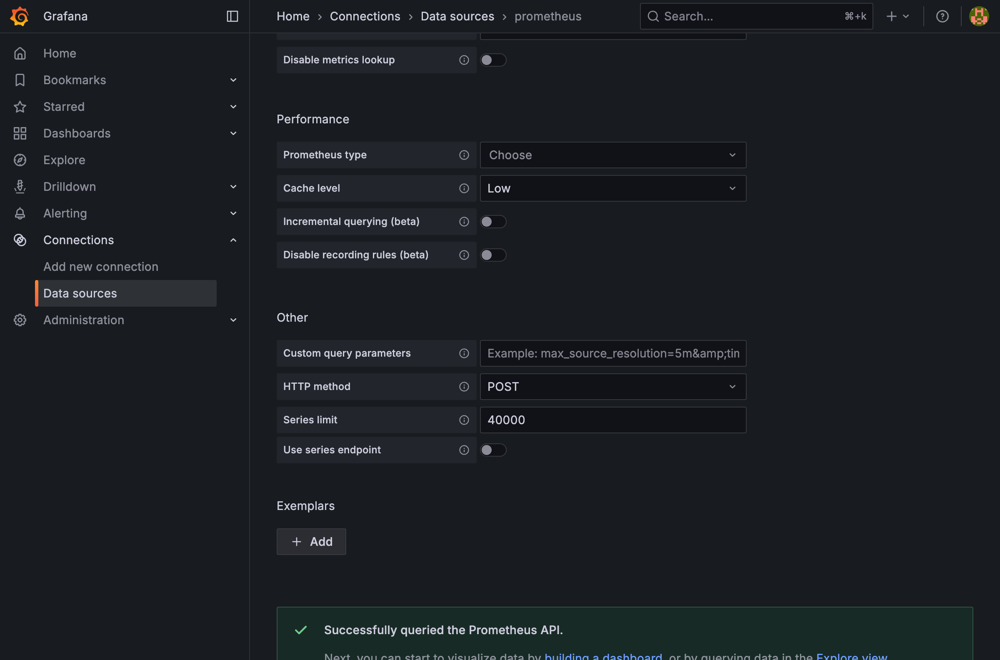
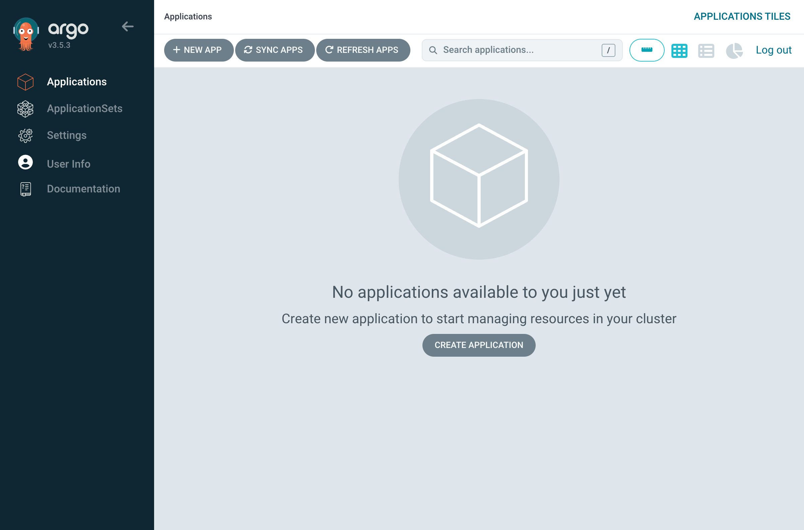
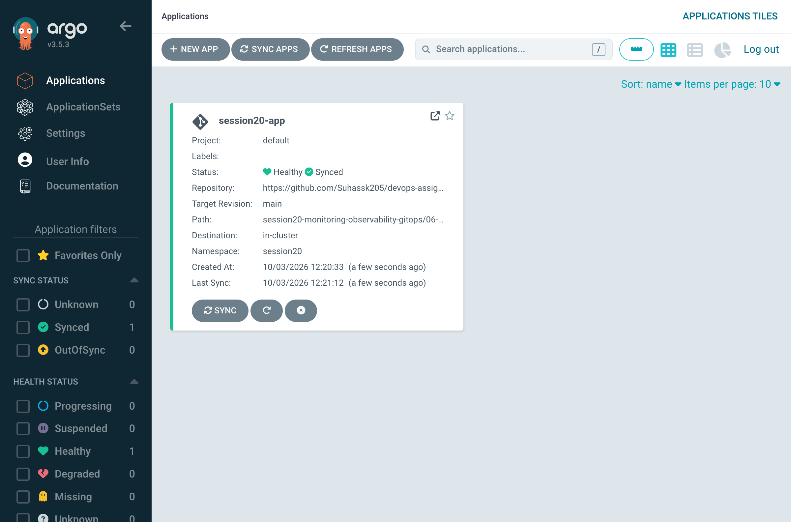

# Session 20: Monitoring, Observability & GitOps

This repository contains the proof of work for monitoring, observability, and GitOps deployments.

## Task 1: Monitoring with Prometheus & Grafana
We successfully deployed the Prometheus stack and configured Grafana to visualize metrics.

### Prometheus Up and Running

### Grafana Datasource Configuration

## Task 2: GitOps with ArgoCD
We integrated ArgoCD to achieve continuous reconciliation from our Git repository to the Kubernetes cluster.

### ArgoCD Dashboard Initialized

### Application Synced via GitOps

