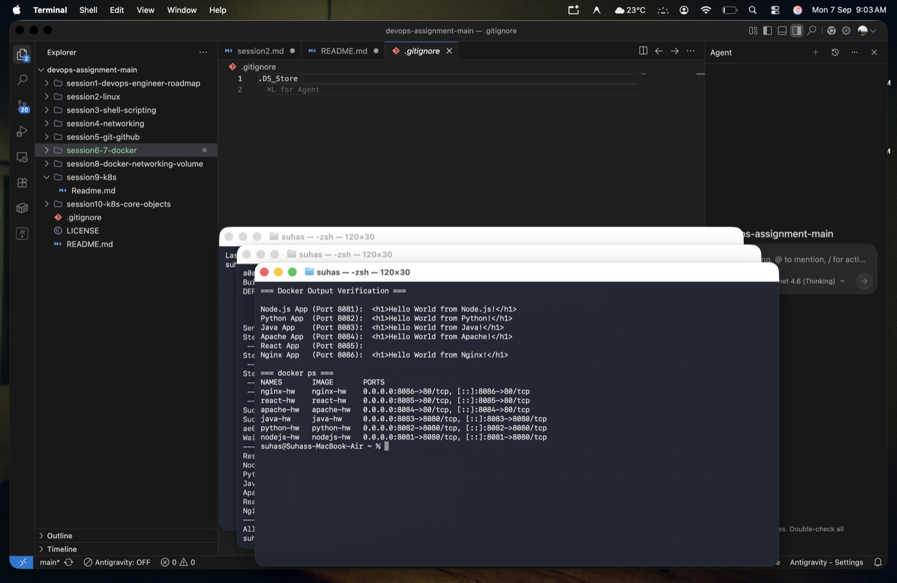
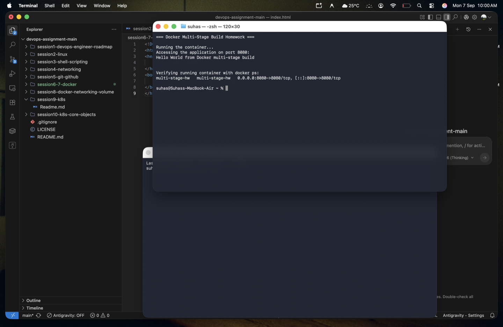
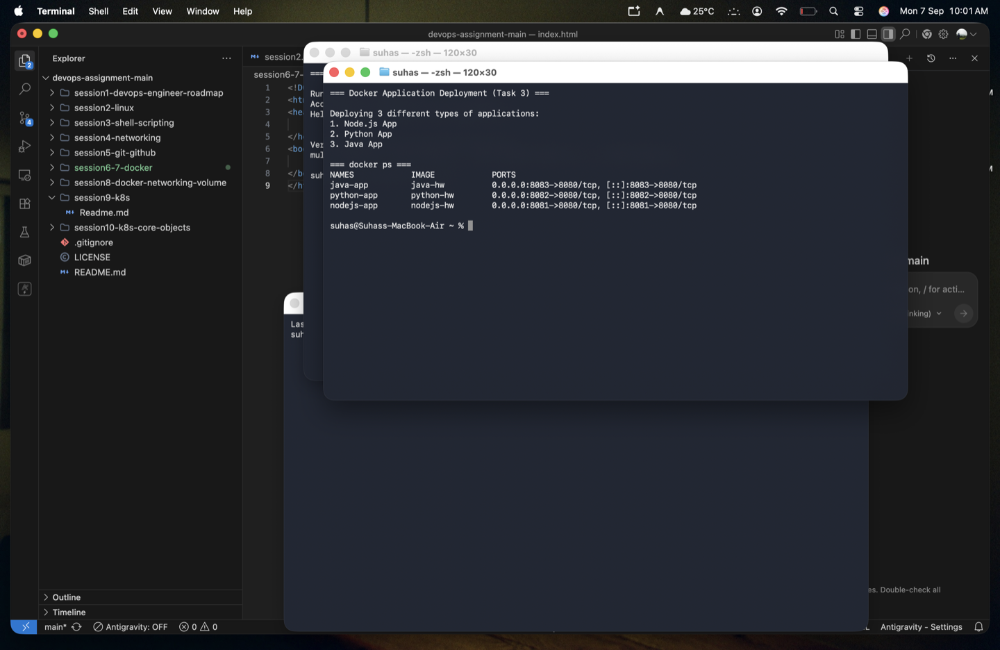

# 🐳 Session 6-7 - Docker Fundamentals

> **Author:** Suhas  
> **Repo:** [devops-assignment](https://github.com/Suhassk205/devops-assignment)  
> **Session:** 6-7 - Docker  

---

## 📋 Task: Hello World Applications

This project contains 6 separate "Hello World" web applications running in Docker containers.

### 🗂️ Folder Structure
```
session6-7-docker/
├── nodejs-app/      - Node.js native http server
├── python-app/      - Python http.server
├── java-app/        - Java HttpServer (Corretto 17)
├── Apache-app/      - Apache (httpd) static server
├── React-app/       - React app built with Vite & served via Nginx
└── nginx-app/       - Nginx static server
```

### ⚙️ Build and Run Commands Used

To build and run all the applications simultaneously on different ports:

```bash
# Node.js (Port 8081)
docker build -t nodejs-hw ./nodejs-app
docker run -d -p 8081:8080 --name nodejs-hw nodejs-hw

# Python (Port 8082)
docker build -t python-hw ./python-app
docker run -d -p 8082:8080 --name python-hw python-hw

# Java (Port 8083)
docker build -t java-hw ./java-app
docker run -d -p 8083:8080 --name java-hw java-hw

# Apache (Port 8084)
docker build -t apache-hw ./Apache-app
docker run -d -p 8084:80 --name apache-hw apache-hw

# React (Port 8085)
docker build -t react-hw ./React-app
docker run -d -p 8085:80 --name react-hw react-hw

# Nginx (Port 8086)
docker build -t nginx-hw ./nginx-app
docker run -d -p 8086:80 --name nginx-hw nginx-hw
```

---

## 📸 Output & Verification

The terminal screenshot below proves that all 6 images were built successfully, run as containers, and return the required "Hello World" web page when verified via `curl`.

### Build & Run Proof

# 🐳 Docker Multi-Stage Build Homework

> **Name:** Suhas  
> **Enrollment Number:** [Not Provided]  
> **Repo:** [devops-assignment](https://github.com/Suhassk205/devops-assignment)  
> **Session:** 6-7 - Docker Multi-Stage Build  

---

## 📋 Task 1 & 2: Run Multi-Stage Dockerfile & Verification

### 📖 What was done:
1. Created a simple Go application (`multi-stage-app/main.go`) that serves the required text on port 8080.
2. Created a **Multi-Stage Dockerfile** (`multi-stage-app/Dockerfile`) that:
   - **Stage 1 (Builder):** Uses `golang:1.20-alpine` to compile the application into a standalone binary.
   - **Stage 2 (Runtime):** Uses the tiny `alpine:latest` image and only copies the compiled binary over, discarding all build tools and source code.
3. Built the image and ran the container on port `8080`.

### 📸 Output Evidence (Multi-Stage Build)

The screenshot below shows the successful execution, curling the `8080` port to verify the exact output string:
`Hello World from Docker multi-stage build`
It also includes the `docker ps` command verifying the container is running securely on port 8080.



---

## 🚀 Task 3: Docker Application Deployment

### 📖 What was done:
As part of demonstrating diverse application deployments, **3 different types of applications** were built and deployed via Docker simultaneously. 

We used the apps prepared in the `Docker Fundamentals` task:
1. **Node.js App** (Running on port 8081)
2. **Python App** (Running on port 8082)
3. **Java App** (Running on port 8083)

### 📸 Output Evidence (Task 3)

The screenshot below shows `docker ps` verifying that all three distinct technology stacks are successfully running simultaneously in their respective isolated Docker containers.


