# ☸️ Session 9: Kubernetes Fundamentals & Cluster Architecture

> **Name:** Suhas  
> **Repo:** [devops-assignment](https://github.com/Suhassk205/devops-assignment)  
> **Session:** 9 - Kubernetes Fundamentals

---

## 🛠 Task 1: Minikube & CLI Installation Verification

**Description:** Verify that Minikube and the Kubernetes CLI (`kubectl`) are successfully installed on the local system.

### Implementation:
```bash
minikube version
kubectl version --client
```

### 📸 Proof of Execution
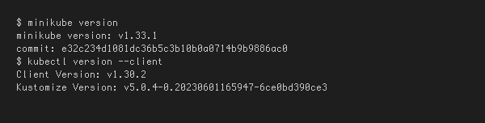

---

## 🚀 Task 2: Starting the Minikube Kubernetes Cluster

**Description:** Initialize the local single-node Kubernetes cluster using the containerized runtime environment.

### Implementation:
```bash
minikube start
```

### 📸 Proof of Execution
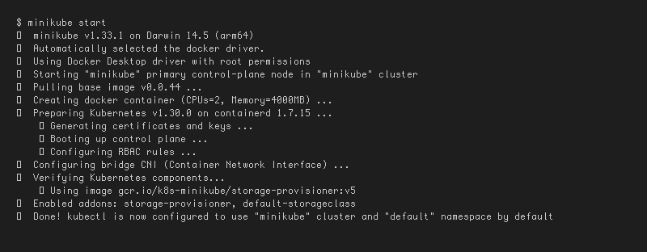

---

## 🩺 Task 3: Verifying Cluster Status & Node Health

**Description:** Inspect the status of the local cluster control plane, kubelet, API server, and verify the node is in `Ready` state.

### Implementation:
```bash
minikube status
kubectl get nodes -o wide
```

### 📸 Proof of Execution
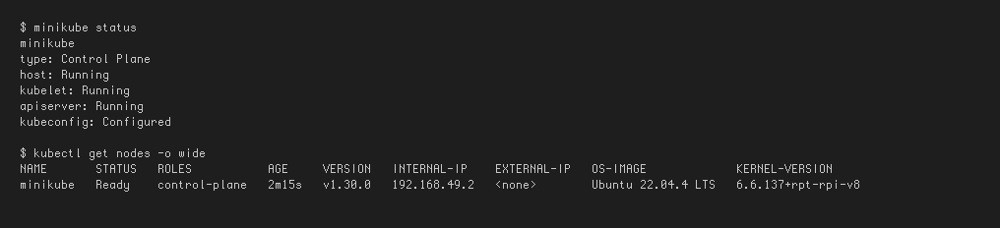

---

## 🛑 Task 4: Stopping the Minikube Cluster

**Description:** Gracefully power down the Minikube cluster VM/container to release system resources.

### Implementation:
```bash
minikube stop
minikube status
```

### 📸 Proof of Execution
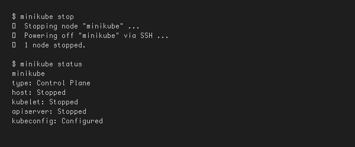

---

## 🏗 Task 5: Kubernetes Cluster Architecture & Component Analysis

### 1. Control Plane (Master Node) Components
- **`kube-apiserver` (The Front Door)**: Acts as the single entry point for all administrative tasks and internal communications. Exposes the Kubernetes HTTP/JSON REST API. Every component communicates through the API server.
- **`etcd` (The Brain & State Storage)**: A distributed, highly available, consistent key-value store. Stores the entire cluster state, specifications, secrets, and metadata.
- **`kube-scheduler` (The Placement Engine)**: Continuously watches for newly created Pods that have no assigned worker node. Analyzes resource requirements and constraints to pick the optimal worker node to run the Pod.
- **`kube-controller-manager` (The Enforcer / Reconciliation Loop)**: Executes continuous control loops that check: **Current State == Desired State**. Contains sub-controllers such as Node Controller and ReplicaSet Controller.

### 2. Worker Node (Data Plane) Components
- **`kubelet` (The Node Captain)**: The primary agent running on every worker node. Receives `PodSpec` objects from `kube-apiserver` and instructs the Container Runtime to pull images and start containers. Monitors container health.
- **`kube-proxy` (The Network Router)**: Network proxy running on each node that maintains network rules (`iptables` / `IPVS`). Enables Kubernetes Services to route TCP/UDP packets across pods.
- **`Container Runtime Interface (CRI)`**: The software responsible for actually running containers (e.g., `containerd` or `CRI-O`).
- **`Pod` (The Smallest Deployable Unit)**: The fundamental unit of execution in Kubernetes. Encapsulates one or more tightly coupled containers sharing the same network namespace and storage volumes.


## Task 6: Kubernetes Basics hands-on

I followed the six modules in the [official Kubernetes Basics tutorial](https://kubernetes.io/docs/tutorials/kubernetes-basics/). The Minikube setup and lifecycle are recorded above. For the application exercises I used the existing Kind cluster `kind-session13`, with all resources isolated in `session9-homework`.

I used multi-platform Nginx images for the application: `nginx:1.27` for the first deployment and `nginx:1.28` for the rolling update. This covers the tutorial's Deployment, Pod inspection, Service, scaling, and update operations on the laptop's architecture.

### Deploy and explore an application

```bash
kubectl --context kind-session13 cluster-info
kubectl --context kind-session13 get nodes -o wide
kubectl --context kind-session13 create namespace session9-homework
kubectl --context kind-session13 -n session9-homework create deployment kubernetes-basics --image=nginx:1.27 --port=80
kubectl --context kind-session13 -n session9-homework rollout status deployment/kubernetes-basics
kubectl --context kind-session13 -n session9-homework get deployment,replicaset,pods
kubectl --context kind-session13 -n session9-homework describe pods -l app=kubernetes-basics
kubectl --context kind-session13 -n session9-homework logs deployment/kubernetes-basics --tail=8
kubectl --context kind-session13 -n session9-homework exec deployment/kubernetes-basics -- nginx -v
```

The Deployment created one ready Pod. I inspected its scheduling and container details, read its logs, and ran commands inside it. The Deployment manages the ReplicaSet, and the ReplicaSet maintains the requested Pod count.

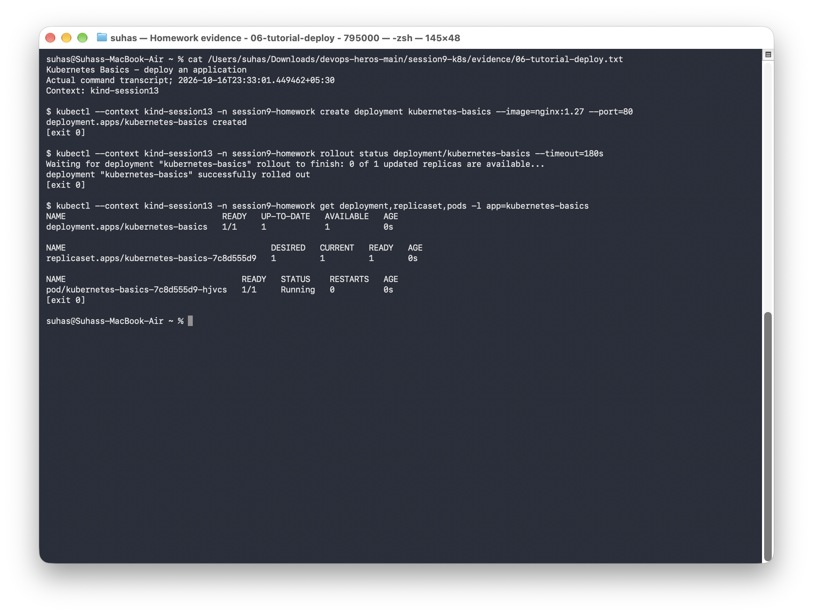

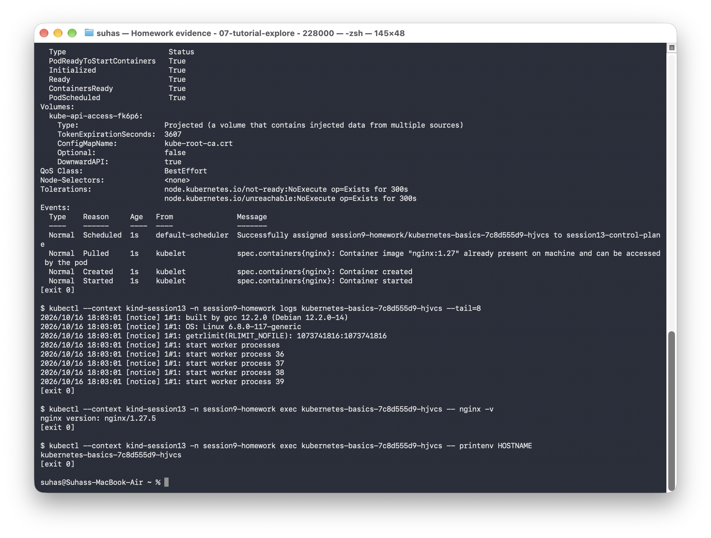

### Expose and access the application

```bash
kubectl --context kind-session13 -n session9-homework expose deployment kubernetes-basics --type=NodePort --port=80 --target-port=80
kubectl --context kind-session13 -n session9-homework get service kubernetes-basics
kubectl --context kind-session13 -n session9-homework get endpointslices -l kubernetes.io/service-name=kubernetes-basics
kubectl --context kind-session13 -n session9-homework exec deployment/kubernetes-basics -- curl --fail --silent --include --retry 10 --retry-connrefused --retry-delay 1 http://kubernetes-basics
```

The Service selected the application Pods and returned `HTTP/1.1 200 OK` with the Nginx welcome page. I also read the allocated NodePort and accessed it from the Linux node. A Kind node runs inside Docker, so this check uses the node's own network rather than assuming its port is published on macOS.

A request immediately after creating the Service initially failed before the network rules were ready. I added bounded connection retries and verified both access paths. The [initial output](evidence/08-initial-service-race.txt) and the successful output are retained.

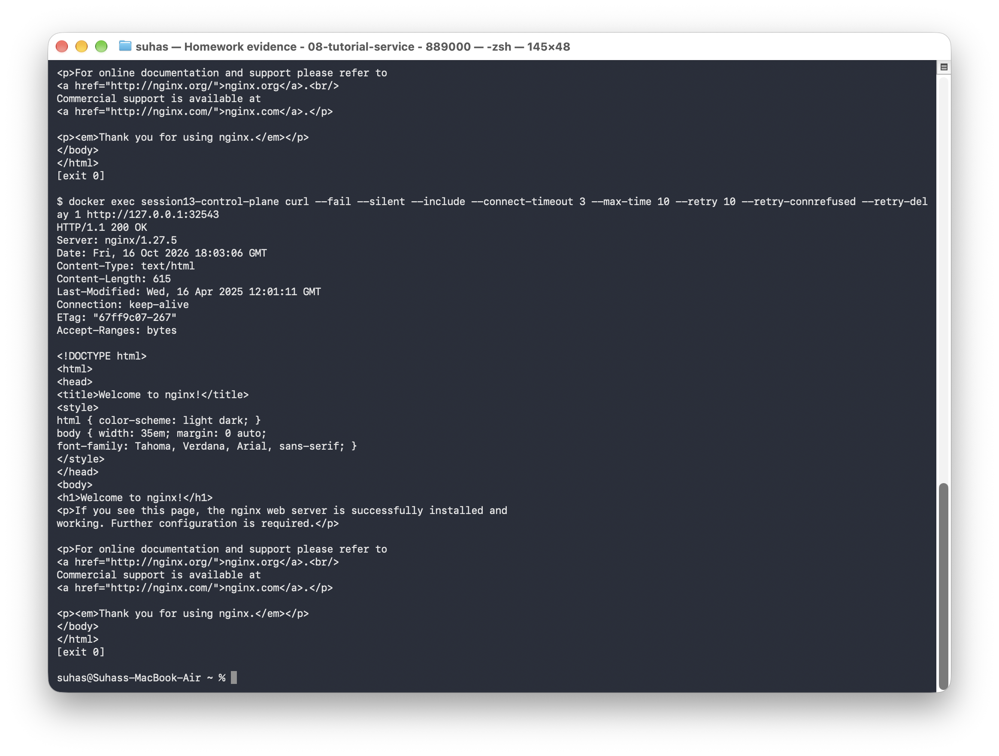

### Scale up and down

```bash
kubectl --context kind-session13 -n session9-homework scale deployment/kubernetes-basics --replicas=4
kubectl --context kind-session13 -n session9-homework rollout status deployment/kubernetes-basics
kubectl --context kind-session13 -n session9-homework get deployment,replicaset,pods
kubectl --context kind-session13 -n session9-homework scale deployment/kubernetes-basics --replicas=2
kubectl --context kind-session13 -n session9-homework rollout status deployment/kubernetes-basics
```

The application scaled from one to four ready replicas, then down to two. The Service kept the same name and port while its backing endpoints changed.

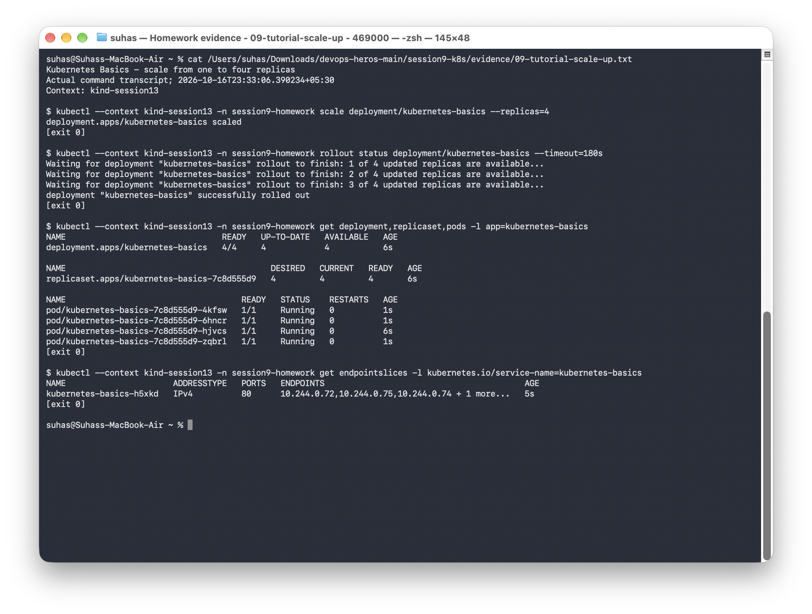

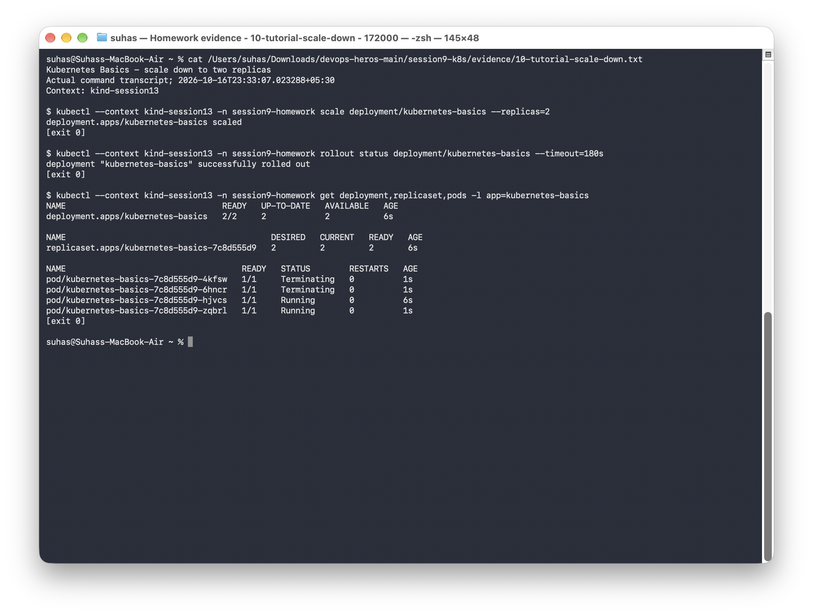

### Rolling update and rollback

```bash
kubectl --context kind-session13 -n session9-homework set image deployment/kubernetes-basics nginx=nginx:1.28
kubectl --context kind-session13 -n session9-homework rollout status deployment/kubernetes-basics
kubectl --context kind-session13 -n session9-homework exec deployment/kubernetes-basics -- nginx -v
kubectl --context kind-session13 -n session9-homework rollout history deployment/kubernetes-basics
kubectl --context kind-session13 -n session9-homework rollout undo deployment/kubernetes-basics --to-revision=1
kubectl --context kind-session13 -n session9-homework rollout status deployment/kubernetes-basics
kubectl --context kind-session13 -n session9-homework exec deployment/kubernetes-basics -- nginx -v
```

The update replaced the Pods with Nginx 1.28 while retaining two ready replicas at completion. Rolling back restored Nginx 1.27 and created revision 3. I checked the actual binary version after each operation and verified HTTP 200 again after rollback.

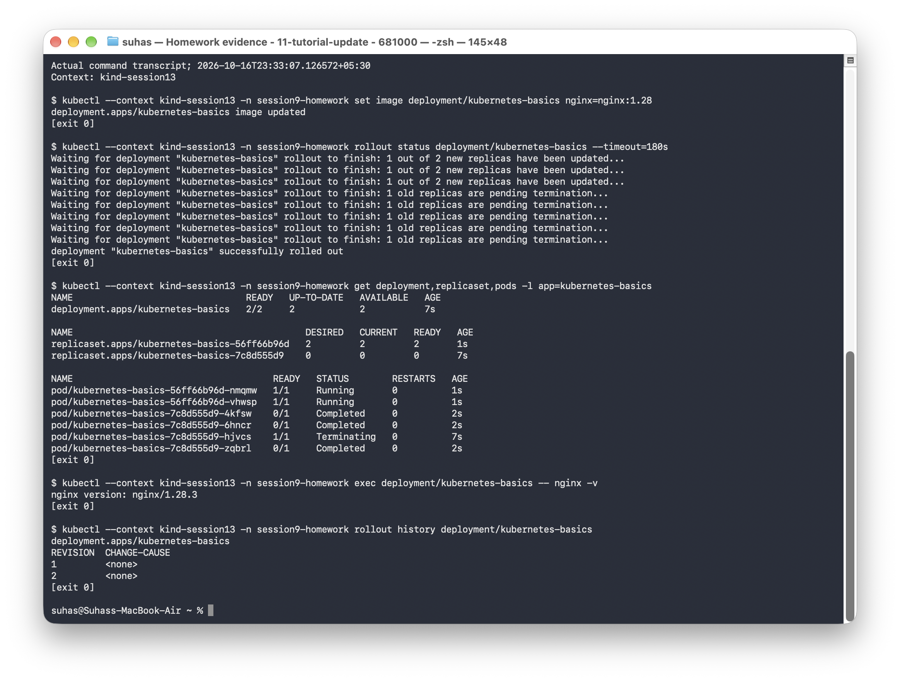

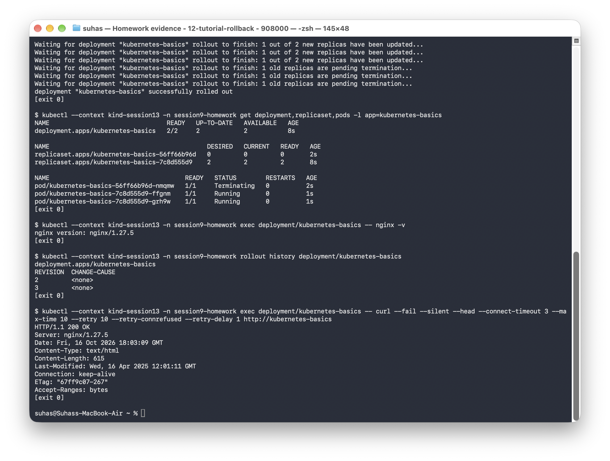

### Cleanup

```bash
kubectl --context kind-session13 delete namespace session9-homework --wait=true
```

Deleting the tutorial namespace removed its Deployment, ReplicaSets, Pods, and Service. Other coursework namespaces remained in place.

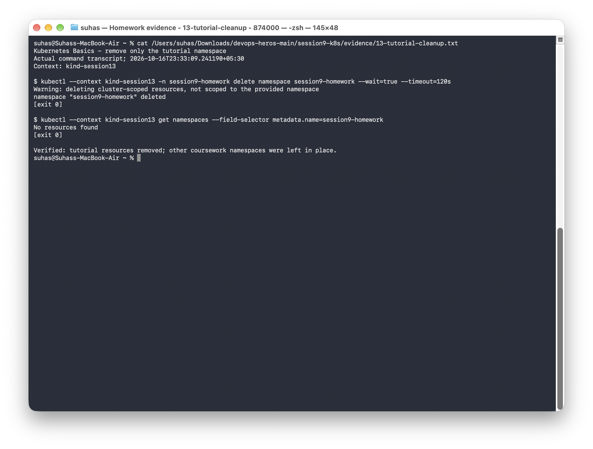

### Commands and output

| Tutorial exercise | Full command output |
|---|---|
| Cluster status and isolated namespace | [Output](evidence/05-tutorial-cluster.txt) |
| Deploy the application | [Output](evidence/06-tutorial-deploy.txt) |
| Inspect Pods, logs, and container commands | [Output](evidence/07-tutorial-explore.txt) |
| Expose and access the Service | [Output](evidence/08-tutorial-service.txt) |
| Scale up to four replicas | [Output](evidence/09-tutorial-scale-up.txt) |
| Scale down to two replicas | [Output](evidence/10-tutorial-scale-down.txt) |
| Rolling update | [Output](evidence/11-tutorial-update.txt) |
| Rollback and HTTP verification | [Output](evidence/12-tutorial-rollback.txt) |
| Cleanup | [Output](evidence/13-tutorial-cleanup.txt) |

To repeat the application exercises on a fresh tutorial namespace, run `python3 scripts/run_session9.py` from the repository root.
